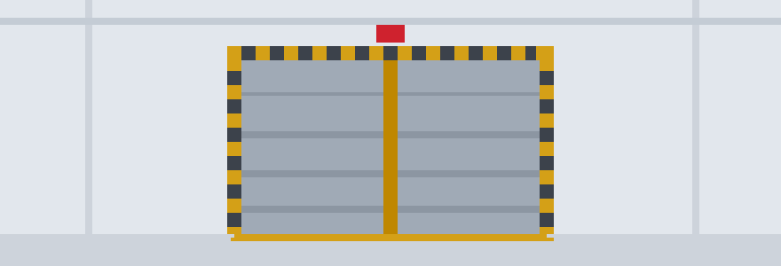

<div align="center">

<picture>
  <source media="(prefers-color-scheme: dark)" srcset="assets/kamera-dark.svg">
  
</picture>

**Game developer from Istanbul** · building [AREA58](https://store.steampowered.com/search/?term=AREA58) at The Surveyors Labs · [LinkedIn](https://www.linkedin.com/in/emirhan-gul)

<picture>
  <source media="(prefers-color-scheme: dark)" srcset="https://raw.githubusercontent.com/Egroses/Egroses/output/stealth-dark.svg">
  
</picture>

<sub>A year of commits as cover. A new level every day, five guards, one intruder who is never seen.</sub>

<details>
<summary><b>🚪&nbsp;Enter the facility</b></summary>

<picture>
  <source media="(prefers-color-scheme: dark)" srcset="assets/kapi-dark.gif">
  
</picture>

<div align="left">

### 🎯 Current mission: AREA58

An online co-op stealth-escape game for 1–6 players, made with Unity and Mirror at **The Surveyors Labs**.

Under the hood: an event hub, MVVM UI, hierarchical state machines, delta sync, object pooling, and a one-command Steam build pipeline (SteamPipe + GitHub Actions).

### 🗂️ Path so far

| When | Where | What |
|---|---|---|
| 2024 – now | The Surveyors Labs | Co-founder, game developer |
| 2024 – 2026 | GameSTEAM | Lead developer: Erasmus+ mobile and AR learning apps, built with partners from 8 European countries |
| 2023 – 2026 | Lux Medius | Lead developer: web solutions for clients |
| 2023 – 2024 | Wayfarer Solutions | Game developer: Unity WebGL, Keycloak magic-link login |
| 2022 – 2023 | G Play Studio | Game developer, intern to full-time: mobile games |
| 2020 – 2024 | Marmara University | Computer Engineering |

### 🧰 Toolbox

`Unity` `C#` `Mirror` `WebGL` `AR` `ASP.NET` `SQL` `REST` `JavaScript` `TypeScript` `Python` `GitHub Actions` `SteamPipe`

### 🕹️ Some public projects

<table>
<tr>
<td align="center" width="33%"><a href="https://github.com/Egroses/NinjaNindo"></a><br><b>NinjaNindo</b><br><sub>Mobile runner with a returning shuriken</sub></td>
<td align="center" width="33%"><a href="https://github.com/Egroses/ScoutsBattle"></a><br><b>ScoutsBattle</b><br><sub>Idle camp builder with army battles</sub></td>
<td align="center" width="33%"><a href="https://github.com/Egroses/AgentSmith"></a><br><b>AgentSmith</b><br><sub>Swerve runner with weapon gates</sub></td>
</tr>
<tr>
<td align="center"><a href="https://github.com/Egroses/ORG-E"></a><br><b>Sky Quest</b><br><sub>NASA Space Apps 2026, team project: SPHEREx images as flip books</sub></td>
<td align="center"><a href="https://github.com/Egroses/ZombieIsland"></a><br><b>Zombie Island</b><br><sub>Survive three days on a zombie island</sub></td>
<td align="center"><a href="https://github.com/Egroses/Museum-Rental-System"></a><br><b>Museum Rental System</b><br><sub>JavaFX + MySQL desktop app</sub></td>
</tr>
</table>

### 🎥 The camera that watched you come in

<sub>Drag to rotate, scroll to zoom.</sub>

```stl
solid camera
facet normal 0.071 0.177 -0.982
outer loop
vertex 16.4 115.2 160.2
vertex 68.3 94.3 160.2
vertex -10.8 -101.4 119.2
endloop
endfacet
facet normal 0.071 0.177 -0.982
outer loop
vertex 16.4 115.2 160.2
vertex -10.8 -101.4 119.2
vertex -62.7 -80.5 119.2
endloop
endfacet
facet normal 0.706 -0.140 -0.694
outer loop
vertex 68.3 94.3 160.2
vertex 82.0 85.4 175.9
vertex 2.9 -110.3 134.9
endloop
endfacet
facet normal 0.706 -0.140 -0.694
outer loop
vertex 68.3 94.3 160.2
vertex 2.9 -110.3 134.9
vertex -10.8 -101.4 119.2
endloop
endfacet
facet normal 0.927 -0.375 -0.000
outer loop
vertex 82.0 85.4 175.9
vertex 78.7 77.3 221.1
vertex -0.4 -118.4 180.1
endloop
endfacet
facet normal 0.927 -0.375 -0.000
outer loop
vertex 82.0 85.4 175.9
vertex -0.4 -118.4 180.1
vertex 2.9 -110.3 134.9
endloop
endfacet
facet normal 0.605 -0.390 0.694
outer loop
vertex 78.7 77.3 221.1
vertex 62.7 80.5 236.8
vertex -16.4 -115.2 195.8
endloop
endfacet
facet normal 0.605 -0.390 0.694
outer loop
vertex 78.7 77.3 221.1
vertex -16.4 -115.2 195.8
vertex -0.4 -118.4 180.1
endloop
endfacet
facet normal -0.071 -0.177 0.982
outer loop
vertex 62.7 80.5 236.8
vertex 10.8 101.4 236.8
vertex -68.3 -94.3 195.8
endloop
endfacet
facet normal -0.071 -0.177 0.982
outer loop
vertex 62.7 80.5 236.8
vertex -68.3 -94.3 195.8
vertex -16.4 -115.2 195.8
endloop
endfacet
facet normal -0.706 0.140 0.694
outer loop
vertex 10.8 101.4 236.8
vertex -2.9 110.3 221.1
vertex -82.0 -85.4 180.1
endloop
endfacet
facet normal -0.706 0.140 0.694
outer loop
vertex 10.8 101.4 236.8
vertex -82.0 -85.4 180.1
vertex -68.3 -94.3 195.8
endloop
endfacet
facet normal -0.927 0.375 0.000
outer loop
vertex -2.9 110.3 221.1
vertex 0.4 118.4 175.9
vertex -78.7 -77.3 134.9
endloop
endfacet
facet normal -0.927 0.375 0.000
outer loop
vertex -2.9 110.3 221.1
vertex -78.7 -77.3 134.9
vertex -82.0 -85.4 180.1
endloop
endfacet
facet normal -0.605 0.390 -0.694
outer loop
vertex 0.4 118.4 175.9
vertex 16.4 115.2 160.2
vertex -62.7 -80.5 119.2
endloop
endfacet
facet normal -0.605 0.390 -0.694
outer loop
vertex 0.4 118.4 175.9
vertex -62.7 -80.5 119.2
vertex -78.7 -77.3 134.9
endloop
endfacet
facet normal -0.368 -0.910 -0.191
outer loop
vertex -62.7 -80.5 119.2
vertex -10.8 -101.4 119.2
vertex 2.9 -110.3 134.9
endloop
endfacet
facet normal -0.368 -0.910 -0.191
outer loop
vertex -62.7 -80.5 119.2
vertex 2.9 -110.3 134.9
vertex -0.4 -118.4 180.1
endloop
endfacet
facet normal -0.368 -0.910 -0.191
outer loop
vertex -62.7 -80.5 119.2
vertex -0.4 -118.4 180.1
vertex -16.4 -115.2 195.8
endloop
endfacet
facet normal -0.368 -0.910 -0.191
outer loop
vertex -62.7 -80.5 119.2
vertex -16.4 -115.2 195.8
vertex -68.3 -94.3 195.8
endloop
endfacet
facet normal -0.368 -0.910 -0.191
outer loop
vertex -62.7 -80.5 119.2
vertex -68.3 -94.3 195.8
vertex -82.0 -85.4 180.1
endloop
endfacet
facet normal -0.368 -0.910 -0.191
outer loop
vertex -62.7 -80.5 119.2
vertex -82.0 -85.4 180.1
vertex -78.7 -77.3 134.9
endloop
endfacet
facet normal 0.368 0.910 0.191
outer loop
vertex 0.4 118.4 175.9
vertex -2.9 110.3 221.1
vertex 10.8 101.4 236.8
endloop
endfacet
facet normal 0.368 0.910 0.191
outer loop
vertex 0.4 118.4 175.9
vertex 10.8 101.4 236.8
vertex 62.7 80.5 236.8
endloop
endfacet
facet normal 0.368 0.910 0.191
outer loop
vertex 0.4 118.4 175.9
vertex 62.7 80.5 236.8
vertex 78.7 77.3 221.1
endloop
endfacet
facet normal 0.368 0.910 0.191
outer loop
vertex 0.4 118.4 175.9
vertex 78.7 77.3 221.1
vertex 82.0 85.4 175.9
endloop
endfacet
facet normal 0.368 0.910 0.191
outer loop
vertex 0.4 118.4 175.9
vertex 82.0 85.4 175.9
vertex 68.3 94.3 160.2
endloop
endfacet
facet normal 0.368 0.910 0.191
outer loop
vertex 0.4 118.4 175.9
vertex 68.3 94.3 160.2
vertex 16.4 115.2 160.2
endloop
endfacet
facet normal 0.071 0.177 -0.982
outer loop
vertex -13.3 105.9 238.4
vertex 83.1 66.9 238.4
vertex -8.8 -160.6 190.7
endloop
endfacet
facet normal 0.071 0.177 -0.982
outer loop
vertex -13.3 105.9 238.4
vertex -8.8 -160.6 190.7
vertex -105.2 -121.7 190.7
endloop
endfacet
facet normal 0.927 -0.375 0.000
outer loop
vertex 83.1 66.9 238.4
vertex 82.6 65.7 245.3
vertex -9.3 -161.9 197.6
endloop
endfacet
facet normal 0.927 -0.375 -0.000
outer loop
vertex 83.1 66.9 238.4
vertex -9.3 -161.9 197.6
vertex -8.8 -160.6 190.7
endloop
endfacet
facet normal -0.071 -0.177 0.982
outer loop
vertex 82.6 65.7 245.3
vertex -13.8 104.6 245.3
vertex -105.7 -122.9 197.6
endloop
endfacet
facet normal -0.071 -0.177 0.982
outer loop
vertex 82.6 65.7 245.3
vertex -105.7 -122.9 197.6
vertex -9.3 -161.9 197.6
endloop
endfacet
facet normal -0.927 0.375 0.000
outer loop
vertex -13.8 104.6 245.3
vertex -13.3 105.9 238.4
vertex -105.2 -121.7 190.7
endloop
endfacet
facet normal -0.927 0.375 0.000
outer loop
vertex -13.8 104.6 245.3
vertex -105.2 -121.7 190.7
vertex -105.7 -122.9 197.6
endloop
endfacet
facet normal -0.368 -0.910 -0.191
outer loop
vertex -105.2 -121.7 190.7
vertex -8.8 -160.6 190.7
vertex -9.3 -161.9 197.6
endloop
endfacet
facet normal -0.368 -0.910 -0.191
outer loop
vertex -105.2 -121.7 190.7
vertex -9.3 -161.9 197.6
vertex -105.7 -122.9 197.6
endloop
endfacet
facet normal 0.368 0.910 0.191
outer loop
vertex -13.8 104.6 245.3
vertex 82.6 65.7 245.3
vertex 83.1 66.9 238.4
endloop
endfacet
facet normal 0.368 0.910 0.191
outer loop
vertex -13.8 104.6 245.3
vertex 83.1 66.9 238.4
vertex -13.3 105.9 238.4
endloop
endfacet
facet normal 0.071 0.177 -0.982
outer loop
vertex -24.7 77.7 221.8
vertex -18.2 75.1 221.8
vertex -91.7 -106.9 183.6
endloop
endfacet
facet normal 0.071 0.177 -0.982
outer loop
vertex -24.7 77.7 221.8
vertex -91.7 -106.9 183.6
vertex -98.2 -104.3 183.6
endloop
endfacet
facet normal 0.927 -0.375 0.000
outer loop
vertex -18.2 75.1 221.8
vertex -19.3 72.3 237.5
vertex -92.9 -109.8 199.3
endloop
endfacet
facet normal 0.927 -0.375 0.000
outer loop
vertex -18.2 75.1 221.8
vertex -92.9 -109.8 199.3
vertex -91.7 -106.9 183.6
endloop
endfacet
facet normal -0.071 -0.177 0.982
outer loop
vertex -19.3 72.3 237.5
vertex -25.8 74.9 237.5
vertex -99.4 -107.2 199.3
endloop
endfacet
facet normal -0.071 -0.177 0.982
outer loop
vertex -19.3 72.3 237.5
vertex -99.4 -107.2 199.3
vertex -92.9 -109.8 199.3
endloop
endfacet
facet normal -0.927 0.375 0.000
outer loop
vertex -25.8 74.9 237.5
vertex -24.7 77.7 221.8
vertex -98.2 -104.3 183.6
endloop
endfacet
facet normal -0.927 0.375 0.000
outer loop
vertex -25.8 74.9 237.5
vertex -98.2 -104.3 183.6
vertex -99.4 -107.2 199.3
endloop
endfacet
facet normal -0.368 -0.910 -0.191
outer loop
vertex -98.2 -104.3 183.6
vertex -91.7 -106.9 183.6
vertex -92.9 -109.8 199.3
endloop
endfacet
facet normal -0.368 -0.910 -0.191
outer loop
vertex -98.2 -104.3 183.6
vertex -92.9 -109.8 199.3
vertex -99.4 -107.2 199.3
endloop
endfacet
facet normal 0.368 0.910 0.191
outer loop
vertex -25.8 74.9 237.5
vertex -19.3 72.3 237.5
vertex -18.2 75.1 221.8
endloop
endfacet
facet normal 0.368 0.910 0.191
outer loop
vertex -25.8 74.9 237.5
vertex -18.2 75.1 221.8
vertex -24.7 77.7 221.8
endloop
endfacet
facet normal 0.071 0.177 -0.982
outer loop
vertex 65.2 41.4 221.8
vertex 71.7 38.7 221.8
vertex -1.8 -143.3 183.6
endloop
endfacet
facet normal 0.071 0.177 -0.982
outer loop
vertex 65.2 41.4 221.8
vertex -1.8 -143.3 183.6
vertex -8.3 -140.7 183.6
endloop
endfacet
facet normal 0.927 -0.375 0.000
outer loop
vertex 71.7 38.7 221.8
vertex 70.6 35.9 237.5
vertex -3.0 -146.1 199.3
endloop
endfacet
facet normal 0.927 -0.375 0.000
outer loop
vertex 71.7 38.7 221.8
vertex -3.0 -146.1 199.3
vertex -1.8 -143.3 183.6
endloop
endfacet
facet normal -0.071 -0.177 0.982
outer loop
vertex 70.6 35.9 237.5
vertex 64.1 38.5 237.5
vertex -9.4 -143.5 199.3
endloop
endfacet
facet normal -0.071 -0.177 0.982
outer loop
vertex 70.6 35.9 237.5
vertex -9.4 -143.5 199.3
vertex -3.0 -146.1 199.3
endloop
endfacet
facet normal -0.927 0.375 0.000
outer loop
vertex 64.1 38.5 237.5
vertex 65.2 41.4 221.8
vertex -8.3 -140.7 183.6
endloop
endfacet
facet normal -0.927 0.375 0.000
outer loop
vertex 64.1 38.5 237.5
vertex -8.3 -140.7 183.6
vertex -9.4 -143.5 199.3
endloop
endfacet
facet normal -0.368 -0.910 -0.191
outer loop
vertex -8.3 -140.7 183.6
vertex -1.8 -143.3 183.6
vertex -3.0 -146.1 199.3
endloop
endfacet
facet normal -0.368 -0.910 -0.191
outer loop
vertex -8.3 -140.7 183.6
vertex -3.0 -146.1 199.3
vertex -9.4 -143.5 199.3
endloop
endfacet
facet normal 0.368 0.910 0.191
outer loop
vertex 64.1 38.5 237.5
vertex 70.6 35.9 237.5
vertex 71.7 38.7 221.8
endloop
endfacet
facet normal 0.368 0.910 0.191
outer loop
vertex 64.1 38.5 237.5
vertex 71.7 38.7 221.8
vertex 65.2 41.4 221.8
endloop
endfacet
facet normal 0.981 0.195 0.000
outer loop
vertex 75.0 0.0 0.0
vertex 69.3 28.7 0.0
vertex 69.3 28.7 14.0
endloop
endfacet
facet normal 0.981 0.195 0.000
outer loop
vertex 75.0 0.0 0.0
vertex 69.3 28.7 14.0
vertex 75.0 0.0 14.0
endloop
endfacet
facet normal 0.831 0.556 0.000
outer loop
vertex 69.3 28.7 0.0
vertex 53.0 53.0 0.0
vertex 53.0 53.0 14.0
endloop
endfacet
facet normal 0.831 0.556 -0.000
outer loop
vertex 69.3 28.7 0.0
vertex 53.0 53.0 14.0
vertex 69.3 28.7 14.0
endloop
endfacet
facet normal 0.556 0.831 0.000
outer loop
vertex 53.0 53.0 0.0
vertex 28.7 69.3 0.0
vertex 28.7 69.3 14.0
endloop
endfacet
facet normal 0.556 0.831 -0.000
outer loop
vertex 53.0 53.0 0.0
vertex 28.7 69.3 14.0
vertex 53.0 53.0 14.0
endloop
endfacet
facet normal 0.195 0.981 0.000
outer loop
vertex 28.7 69.3 0.0
vertex 0.0 75.0 0.0
vertex 0.0 75.0 14.0
endloop
endfacet
facet normal 0.195 0.981 -0.000
outer loop
vertex 28.7 69.3 0.0
vertex 0.0 75.0 14.0
vertex 28.7 69.3 14.0
endloop
endfacet
facet normal -0.195 0.981 0.000
outer loop
vertex 0.0 75.0 0.0
vertex -28.7 69.3 0.0
vertex -28.7 69.3 14.0
endloop
endfacet
facet normal -0.195 0.981 0.000
outer loop
vertex 0.0 75.0 0.0
vertex -28.7 69.3 14.0
vertex 0.0 75.0 14.0
endloop
endfacet
facet normal -0.556 0.831 0.000
outer loop
vertex -28.7 69.3 0.0
vertex -53.0 53.0 0.0
vertex -53.0 53.0 14.0
endloop
endfacet
facet normal -0.556 0.831 0.000
outer loop
vertex -28.7 69.3 0.0
vertex -53.0 53.0 14.0
vertex -28.7 69.3 14.0
endloop
endfacet
facet normal -0.831 0.556 0.000
outer loop
vertex -53.0 53.0 0.0
vertex -69.3 28.7 0.0
vertex -69.3 28.7 14.0
endloop
endfacet
facet normal -0.831 0.556 0.000
outer loop
vertex -53.0 53.0 0.0
vertex -69.3 28.7 14.0
vertex -53.0 53.0 14.0
endloop
endfacet
facet normal -0.981 0.195 0.000
outer loop
vertex -69.3 28.7 0.0
vertex -75.0 0.0 0.0
vertex -75.0 0.0 14.0
endloop
endfacet
facet normal -0.981 0.195 0.000
outer loop
vertex -69.3 28.7 0.0
vertex -75.0 0.0 14.0
vertex -69.3 28.7 14.0
endloop
endfacet
facet normal -0.981 -0.195 0.000
outer loop
vertex -75.0 0.0 0.0
vertex -69.3 -28.7 0.0
vertex -69.3 -28.7 14.0
endloop
endfacet
facet normal -0.981 -0.195 -0.000
outer loop
vertex -75.0 0.0 0.0
vertex -69.3 -28.7 14.0
vertex -75.0 0.0 14.0
endloop
endfacet
facet normal -0.831 -0.556 0.000
outer loop
vertex -69.3 -28.7 0.0
vertex -53.0 -53.0 0.0
vertex -53.0 -53.0 14.0
endloop
endfacet
facet normal -0.831 -0.556 0.000
outer loop
vertex -69.3 -28.7 0.0
vertex -53.0 -53.0 14.0
vertex -69.3 -28.7 14.0
endloop
endfacet
facet normal -0.556 -0.831 0.000
outer loop
vertex -53.0 -53.0 0.0
vertex -28.7 -69.3 0.0
vertex -28.7 -69.3 14.0
endloop
endfacet
facet normal -0.556 -0.831 0.000
outer loop
vertex -53.0 -53.0 0.0
vertex -28.7 -69.3 14.0
vertex -53.0 -53.0 14.0
endloop
endfacet
facet normal -0.195 -0.981 0.000
outer loop
vertex -28.7 -69.3 0.0
vertex 0.0 -75.0 0.0
vertex 0.0 -75.0 14.0
endloop
endfacet
facet normal -0.195 -0.981 0.000
outer loop
vertex -28.7 -69.3 0.0
vertex 0.0 -75.0 14.0
vertex -28.7 -69.3 14.0
endloop
endfacet
facet normal 0.195 -0.981 0.000
outer loop
vertex 0.0 -75.0 0.0
vertex 28.7 -69.3 0.0
vertex 28.7 -69.3 14.0
endloop
endfacet
facet normal 0.195 -0.981 0.000
outer loop
vertex 0.0 -75.0 0.0
vertex 28.7 -69.3 14.0
vertex 0.0 -75.0 14.0
endloop
endfacet
facet normal 0.556 -0.831 0.000
outer loop
vertex 28.7 -69.3 0.0
vertex 53.0 -53.0 0.0
vertex 53.0 -53.0 14.0
endloop
endfacet
facet normal 0.556 -0.831 0.000
outer loop
vertex 28.7 -69.3 0.0
vertex 53.0 -53.0 14.0
vertex 28.7 -69.3 14.0
endloop
endfacet
facet normal 0.831 -0.556 0.000
outer loop
vertex 53.0 -53.0 0.0
vertex 69.3 -28.7 0.0
vertex 69.3 -28.7 14.0
endloop
endfacet
facet normal 0.831 -0.556 0.000
outer loop
vertex 53.0 -53.0 0.0
vertex 69.3 -28.7 14.0
vertex 53.0 -53.0 14.0
endloop
endfacet
facet normal 0.981 -0.195 0.000
outer loop
vertex 69.3 -28.7 0.0
vertex 75.0 0.0 0.0
vertex 75.0 0.0 14.0
endloop
endfacet
facet normal 0.981 -0.195 0.000
outer loop
vertex 69.3 -28.7 0.0
vertex 75.0 0.0 14.0
vertex 69.3 -28.7 14.0
endloop
endfacet
facet normal 0.000 -0.000 1.000
outer loop
vertex 75.0 0.0 14.0
vertex 69.3 28.7 14.0
vertex 53.0 53.0 14.0
endloop
endfacet
facet normal -0.000 -0.000 1.000
outer loop
vertex 75.0 0.0 14.0
vertex 53.0 53.0 14.0
vertex 28.7 69.3 14.0
endloop
endfacet
facet normal 0.000 -0.000 1.000
outer loop
vertex 75.0 0.0 14.0
vertex 28.7 69.3 14.0
vertex 0.0 75.0 14.0
endloop
endfacet
facet normal -0.000 -0.000 1.000
outer loop
vertex 75.0 0.0 14.0
vertex 0.0 75.0 14.0
vertex -28.7 69.3 14.0
endloop
endfacet
facet normal 0.000 -0.000 1.000
outer loop
vertex 75.0 0.0 14.0
vertex -28.7 69.3 14.0
vertex -53.0 53.0 14.0
endloop
endfacet
facet normal -0.000 -0.000 1.000
outer loop
vertex 75.0 0.0 14.0
vertex -53.0 53.0 14.0
vertex -69.3 28.7 14.0
endloop
endfacet
facet normal -0.000 -0.000 1.000
outer loop
vertex 75.0 0.0 14.0
vertex -69.3 28.7 14.0
vertex -75.0 0.0 14.0
endloop
endfacet
facet normal -0.000 -0.000 1.000
outer loop
vertex 75.0 0.0 14.0
vertex -75.0 0.0 14.0
vertex -69.3 -28.7 14.0
endloop
endfacet
facet normal 0.000 -0.000 1.000
outer loop
vertex 75.0 0.0 14.0
vertex -69.3 -28.7 14.0
vertex -53.0 -53.0 14.0
endloop
endfacet
facet normal -0.000 -0.000 1.000
outer loop
vertex 75.0 0.0 14.0
vertex -53.0 -53.0 14.0
vertex -28.7 -69.3 14.0
endloop
endfacet
facet normal 0.000 -0.000 1.000
outer loop
vertex 75.0 0.0 14.0
vertex -28.7 -69.3 14.0
vertex 0.0 -75.0 14.0
endloop
endfacet
facet normal -0.000 -0.000 1.000
outer loop
vertex 75.0 0.0 14.0
vertex 0.0 -75.0 14.0
vertex 28.7 -69.3 14.0
endloop
endfacet
facet normal 0.000 -0.000 1.000
outer loop
vertex 75.0 0.0 14.0
vertex 28.7 -69.3 14.0
vertex 53.0 -53.0 14.0
endloop
endfacet
facet normal -0.000 -0.000 1.000
outer loop
vertex 75.0 0.0 14.0
vertex 53.0 -53.0 14.0
vertex 69.3 -28.7 14.0
endloop
endfacet
facet normal 0.000 0.000 -1.000
outer loop
vertex 69.3 -28.7 0.0
vertex 53.0 -53.0 0.0
vertex 28.7 -69.3 0.0
endloop
endfacet
facet normal 0.000 0.000 -1.000
outer loop
vertex 69.3 -28.7 0.0
vertex 28.7 -69.3 0.0
vertex 0.0 -75.0 0.0
endloop
endfacet
facet normal -0.000 0.000 -1.000
outer loop
vertex 69.3 -28.7 0.0
vertex 0.0 -75.0 0.0
vertex -28.7 -69.3 0.0
endloop
endfacet
facet normal 0.000 0.000 -1.000
outer loop
vertex 69.3 -28.7 0.0
vertex -28.7 -69.3 0.0
vertex -53.0 -53.0 0.0
endloop
endfacet
facet normal 0.000 0.000 -1.000
outer loop
vertex 69.3 -28.7 0.0
vertex -53.0 -53.0 0.0
vertex -69.3 -28.7 0.0
endloop
endfacet
facet normal 0.000 0.000 -1.000
outer loop
vertex 69.3 -28.7 0.0
vertex -69.3 -28.7 0.0
vertex -75.0 0.0 0.0
endloop
endfacet
facet normal 0.000 0.000 -1.000
outer loop
vertex 69.3 -28.7 0.0
vertex -75.0 0.0 0.0
vertex -69.3 28.7 0.0
endloop
endfacet
facet normal -0.000 0.000 -1.000
outer loop
vertex 69.3 -28.7 0.0
vertex -69.3 28.7 0.0
vertex -53.0 53.0 0.0
endloop
endfacet
facet normal 0.000 0.000 -1.000
outer loop
vertex 69.3 -28.7 0.0
vertex -53.0 53.0 0.0
vertex -28.7 69.3 0.0
endloop
endfacet
facet normal 0.000 0.000 -1.000
outer loop
vertex 69.3 -28.7 0.0
vertex -28.7 69.3 0.0
vertex 0.0 75.0 0.0
endloop
endfacet
facet normal 0.000 0.000 -1.000
outer loop
vertex 69.3 -28.7 0.0
vertex 0.0 75.0 0.0
vertex 28.7 69.3 0.0
endloop
endfacet
facet normal 0.000 0.000 -1.000
outer loop
vertex 69.3 -28.7 0.0
vertex 28.7 69.3 0.0
vertex 53.0 53.0 0.0
endloop
endfacet
facet normal 0.000 0.000 -1.000
outer loop
vertex 69.3 -28.7 0.0
vertex 53.0 53.0 0.0
vertex 69.3 28.7 0.0
endloop
endfacet
facet normal 0.000 0.000 -1.000
outer loop
vertex 69.3 -28.7 0.0
vertex 69.3 28.7 0.0
vertex 75.0 0.0 0.0
endloop
endfacet
facet normal 0.981 0.195 0.000
outer loop
vertex 11.0 10.0 14.0
vertex 10.2 14.2 14.0
vertex 10.2 14.2 139.0
endloop
endfacet
facet normal 0.981 0.195 0.000
outer loop
vertex 11.0 10.0 14.0
vertex 10.2 14.2 139.0
vertex 11.0 10.0 139.0
endloop
endfacet
facet normal 0.831 0.556 0.000
outer loop
vertex 10.2 14.2 14.0
vertex 7.8 17.8 14.0
vertex 7.8 17.8 139.0
endloop
endfacet
facet normal 0.831 0.556 0.000
outer loop
vertex 10.2 14.2 14.0
vertex 7.8 17.8 139.0
vertex 10.2 14.2 139.0
endloop
endfacet
facet normal 0.556 0.831 0.000
outer loop
vertex 7.8 17.8 14.0
vertex 4.2 20.2 14.0
vertex 4.2 20.2 139.0
endloop
endfacet
facet normal 0.556 0.831 0.000
outer loop
vertex 7.8 17.8 14.0
vertex 4.2 20.2 139.0
vertex 7.8 17.8 139.0
endloop
endfacet
facet normal 0.195 0.981 0.000
outer loop
vertex 4.2 20.2 14.0
vertex 0.0 21.0 14.0
vertex 0.0 21.0 139.0
endloop
endfacet
facet normal 0.195 0.981 0.000
outer loop
vertex 4.2 20.2 14.0
vertex 0.0 21.0 139.0
vertex 4.2 20.2 139.0
endloop
endfacet
facet normal -0.195 0.981 0.000
outer loop
vertex 0.0 21.0 14.0
vertex -4.2 20.2 14.0
vertex -4.2 20.2 139.0
endloop
endfacet
facet normal -0.195 0.981 0.000
outer loop
vertex 0.0 21.0 14.0
vertex -4.2 20.2 139.0
vertex 0.0 21.0 139.0
endloop
endfacet
facet normal -0.556 0.831 0.000
outer loop
vertex -4.2 20.2 14.0
vertex -7.8 17.8 14.0
vertex -7.8 17.8 139.0
endloop
endfacet
facet normal -0.556 0.831 0.000
outer loop
vertex -4.2 20.2 14.0
vertex -7.8 17.8 139.0
vertex -4.2 20.2 139.0
endloop
endfacet
facet normal -0.831 0.556 0.000
outer loop
vertex -7.8 17.8 14.0
vertex -10.2 14.2 14.0
vertex -10.2 14.2 139.0
endloop
endfacet
facet normal -0.831 0.556 0.000
outer loop
vertex -7.8 17.8 14.0
vertex -10.2 14.2 139.0
vertex -7.8 17.8 139.0
endloop
endfacet
facet normal -0.981 0.195 0.000
outer loop
vertex -10.2 14.2 14.0
vertex -11.0 10.0 14.0
vertex -11.0 10.0 139.0
endloop
endfacet
facet normal -0.981 0.195 0.000
outer loop
vertex -10.2 14.2 14.0
vertex -11.0 10.0 139.0
vertex -10.2 14.2 139.0
endloop
endfacet
facet normal -0.981 -0.195 -0.000
outer loop
vertex -11.0 10.0 14.0
vertex -10.2 5.8 14.0
vertex -10.2 5.8 139.0
endloop
endfacet
facet normal -0.981 -0.195 -0.000
outer loop
vertex -11.0 10.0 14.0
vertex -10.2 5.8 139.0
vertex -11.0 10.0 139.0
endloop
endfacet
facet normal -0.831 -0.556 -0.000
outer loop
vertex -10.2 5.8 14.0
vertex -7.8 2.2 14.0
vertex -7.8 2.2 139.0
endloop
endfacet
facet normal -0.831 -0.556 -0.000
outer loop
vertex -10.2 5.8 14.0
vertex -7.8 2.2 139.0
vertex -10.2 5.8 139.0
endloop
endfacet
facet normal -0.556 -0.831 -0.000
outer loop
vertex -7.8 2.2 14.0
vertex -4.2 -0.2 14.0
vertex -4.2 -0.2 139.0
endloop
endfacet
facet normal -0.556 -0.831 -0.000
outer loop
vertex -7.8 2.2 14.0
vertex -4.2 -0.2 139.0
vertex -7.8 2.2 139.0
endloop
endfacet
facet normal -0.195 -0.981 -0.000
outer loop
vertex -4.2 -0.2 14.0
vertex 0.0 -1.0 14.0
vertex 0.0 -1.0 139.0
endloop
endfacet
facet normal -0.195 -0.981 -0.000
outer loop
vertex -4.2 -0.2 14.0
vertex 0.0 -1.0 139.0
vertex -4.2 -0.2 139.0
endloop
endfacet
facet normal 0.195 -0.981 -0.000
outer loop
vertex 0.0 -1.0 14.0
vertex 4.2 -0.2 14.0
vertex 4.2 -0.2 139.0
endloop
endfacet
facet normal 0.195 -0.981 -0.000
outer loop
vertex 0.0 -1.0 14.0
vertex 4.2 -0.2 139.0
vertex 0.0 -1.0 139.0
endloop
endfacet
facet normal 0.556 -0.831 -0.000
outer loop
vertex 4.2 -0.2 14.0
vertex 7.8 2.2 14.0
vertex 7.8 2.2 139.0
endloop
endfacet
facet normal 0.556 -0.831 -0.000
outer loop
vertex 4.2 -0.2 14.0
vertex 7.8 2.2 139.0
vertex 4.2 -0.2 139.0
endloop
endfacet
facet normal 0.831 -0.556 -0.000
outer loop
vertex 7.8 2.2 14.0
vertex 10.2 5.8 14.0
vertex 10.2 5.8 139.0
endloop
endfacet
facet normal 0.831 -0.556 -0.000
outer loop
vertex 7.8 2.2 14.0
vertex 10.2 5.8 139.0
vertex 7.8 2.2 139.0
endloop
endfacet
facet normal 0.981 -0.195 -0.000
outer loop
vertex 10.2 5.8 14.0
vertex 11.0 10.0 14.0
vertex 11.0 10.0 139.0
endloop
endfacet
facet normal 0.981 -0.195 -0.000
outer loop
vertex 10.2 5.8 14.0
vertex 11.0 10.0 139.0
vertex 10.2 5.8 139.0
endloop
endfacet
facet normal 0.000 0.000 1.000
outer loop
vertex 11.0 10.0 139.0
vertex 10.2 14.2 139.0
vertex 7.8 17.8 139.0
endloop
endfacet
facet normal 0.000 0.000 1.000
outer loop
vertex 11.0 10.0 139.0
vertex 7.8 17.8 139.0
vertex 4.2 20.2 139.0
endloop
endfacet
facet normal 0.000 0.000 1.000
outer loop
vertex 11.0 10.0 139.0
vertex 4.2 20.2 139.0
vertex 0.0 21.0 139.0
endloop
endfacet
facet normal 0.000 0.000 1.000
outer loop
vertex 11.0 10.0 139.0
vertex 0.0 21.0 139.0
vertex -4.2 20.2 139.0
endloop
endfacet
facet normal 0.000 0.000 1.000
outer loop
vertex 11.0 10.0 139.0
vertex -4.2 20.2 139.0
vertex -7.8 17.8 139.0
endloop
endfacet
facet normal 0.000 0.000 1.000
outer loop
vertex 11.0 10.0 139.0
vertex -7.8 17.8 139.0
vertex -10.2 14.2 139.0
endloop
endfacet
facet normal 0.000 0.000 1.000
outer loop
vertex 11.0 10.0 139.0
vertex -10.2 14.2 139.0
vertex -11.0 10.0 139.0
endloop
endfacet
facet normal 0.000 0.000 1.000
outer loop
vertex 11.0 10.0 139.0
vertex -11.0 10.0 139.0
vertex -10.2 5.8 139.0
endloop
endfacet
facet normal 0.000 0.000 1.000
outer loop
vertex 11.0 10.0 139.0
vertex -10.2 5.8 139.0
vertex -7.8 2.2 139.0
endloop
endfacet
facet normal 0.000 0.000 1.000
outer loop
vertex 11.0 10.0 139.0
vertex -7.8 2.2 139.0
vertex -4.2 -0.2 139.0
endloop
endfacet
facet normal 0.000 0.000 1.000
outer loop
vertex 11.0 10.0 139.0
vertex -4.2 -0.2 139.0
vertex 0.0 -1.0 139.0
endloop
endfacet
facet normal 0.000 0.000 1.000
outer loop
vertex 11.0 10.0 139.0
vertex 0.0 -1.0 139.0
vertex 4.2 -0.2 139.0
endloop
endfacet
facet normal 0.000 0.000 1.000
outer loop
vertex 11.0 10.0 139.0
vertex 4.2 -0.2 139.0
vertex 7.8 2.2 139.0
endloop
endfacet
facet normal 0.000 0.000 1.000
outer loop
vertex 11.0 10.0 139.0
vertex 7.8 2.2 139.0
vertex 10.2 5.8 139.0
endloop
endfacet
facet normal 0.000 0.000 -1.000
outer loop
vertex 10.2 5.8 14.0
vertex 7.8 2.2 14.0
vertex 4.2 -0.2 14.0
endloop
endfacet
facet normal 0.000 0.000 -1.000
outer loop
vertex 10.2 5.8 14.0
vertex 4.2 -0.2 14.0
vertex 0.0 -1.0 14.0
endloop
endfacet
facet normal 0.000 0.000 -1.000
outer loop
vertex 10.2 5.8 14.0
vertex 0.0 -1.0 14.0
vertex -4.2 -0.2 14.0
endloop
endfacet
facet normal 0.000 0.000 -1.000
outer loop
vertex 10.2 5.8 14.0
vertex -4.2 -0.2 14.0
vertex -7.8 2.2 14.0
endloop
endfacet
facet normal -0.000 0.000 -1.000
outer loop
vertex 10.2 5.8 14.0
vertex -7.8 2.2 14.0
vertex -10.2 5.8 14.0
endloop
endfacet
facet normal 0.000 0.000 -1.000
outer loop
vertex 10.2 5.8 14.0
vertex -10.2 5.8 14.0
vertex -11.0 10.0 14.0
endloop
endfacet
facet normal 0.000 0.000 -1.000
outer loop
vertex 10.2 5.8 14.0
vertex -11.0 10.0 14.0
vertex -10.2 14.2 14.0
endloop
endfacet
facet normal 0.000 0.000 -1.000
outer loop
vertex 10.2 5.8 14.0
vertex -10.2 14.2 14.0
vertex -7.8 17.8 14.0
endloop
endfacet
facet normal 0.000 0.000 -1.000
outer loop
vertex 10.2 5.8 14.0
vertex -7.8 17.8 14.0
vertex -4.2 20.2 14.0
endloop
endfacet
facet normal 0.000 0.000 -1.000
outer loop
vertex 10.2 5.8 14.0
vertex -4.2 20.2 14.0
vertex 0.0 21.0 14.0
endloop
endfacet
facet normal 0.000 0.000 -1.000
outer loop
vertex 10.2 5.8 14.0
vertex 0.0 21.0 14.0
vertex 4.2 20.2 14.0
endloop
endfacet
facet normal 0.000 0.000 -1.000
outer loop
vertex 10.2 5.8 14.0
vertex 4.2 20.2 14.0
vertex 7.8 17.8 14.0
endloop
endfacet
facet normal 0.000 0.000 -1.000
outer loop
vertex 10.2 5.8 14.0
vertex 7.8 17.8 14.0
vertex 10.2 14.2 14.0
endloop
endfacet
facet normal 0.000 0.000 -1.000
outer loop
vertex 10.2 5.8 14.0
vertex 10.2 14.2 14.0
vertex 11.0 10.0 14.0
endloop
endfacet
facet normal 0.000 0.981 0.195
outer loop
vertex -28.0 31.0 142.0
vertex -28.0 29.4 150.0
vertex 28.0 29.4 150.0
endloop
endfacet
facet normal -0.000 0.981 0.195
outer loop
vertex -28.0 31.0 142.0
vertex 28.0 29.4 150.0
vertex 28.0 31.0 142.0
endloop
endfacet
facet normal 0.000 0.831 0.556
outer loop
vertex -28.0 29.4 150.0
vertex -28.0 24.8 156.8
vertex 28.0 24.8 156.8
endloop
endfacet
facet normal -0.000 0.831 0.556
outer loop
vertex -28.0 29.4 150.0
vertex 28.0 24.8 156.8
vertex 28.0 29.4 150.0
endloop
endfacet
facet normal 0.000 0.556 0.831
outer loop
vertex -28.0 24.8 156.8
vertex -28.0 18.0 161.4
vertex 28.0 18.0 161.4
endloop
endfacet
facet normal 0.000 0.556 0.831
outer loop
vertex -28.0 24.8 156.8
vertex 28.0 18.0 161.4
vertex 28.0 24.8 156.8
endloop
endfacet
facet normal 0.000 0.195 0.981
outer loop
vertex -28.0 18.0 161.4
vertex -28.0 10.0 163.0
vertex 28.0 10.0 163.0
endloop
endfacet
facet normal 0.000 0.195 0.981
outer loop
vertex -28.0 18.0 161.4
vertex 28.0 10.0 163.0
vertex 28.0 18.0 161.4
endloop
endfacet
facet normal -0.000 -0.195 0.981
outer loop
vertex -28.0 10.0 163.0
vertex -28.0 2.0 161.4
vertex 28.0 2.0 161.4
endloop
endfacet
facet normal -0.000 -0.195 0.981
outer loop
vertex -28.0 10.0 163.0
vertex 28.0 2.0 161.4
vertex 28.0 10.0 163.0
endloop
endfacet
facet normal -0.000 -0.556 0.831
outer loop
vertex -28.0 2.0 161.4
vertex -28.0 -4.8 156.8
vertex 28.0 -4.8 156.8
endloop
endfacet
facet normal -0.000 -0.556 0.831
outer loop
vertex -28.0 2.0 161.4
vertex 28.0 -4.8 156.8
vertex 28.0 2.0 161.4
endloop
endfacet
facet normal 0.000 -0.831 0.556
outer loop
vertex -28.0 -4.8 156.8
vertex -28.0 -9.4 150.0
vertex 28.0 -9.4 150.0
endloop
endfacet
facet normal -0.000 -0.831 0.556
outer loop
vertex -28.0 -4.8 156.8
vertex 28.0 -9.4 150.0
vertex 28.0 -4.8 156.8
endloop
endfacet
facet normal 0.000 -0.981 0.195
outer loop
vertex -28.0 -9.4 150.0
vertex -28.0 -11.0 142.0
vertex 28.0 -11.0 142.0
endloop
endfacet
facet normal 0.000 -0.981 0.195
outer loop
vertex -28.0 -9.4 150.0
vertex 28.0 -11.0 142.0
vertex 28.0 -9.4 150.0
endloop
endfacet
facet normal 0.000 -0.981 -0.195
outer loop
vertex -28.0 -11.0 142.0
vertex -28.0 -9.4 134.0
vertex 28.0 -9.4 134.0
endloop
endfacet
facet normal 0.000 -0.981 -0.195
outer loop
vertex -28.0 -11.0 142.0
vertex 28.0 -9.4 134.0
vertex 28.0 -11.0 142.0
endloop
endfacet
facet normal -0.000 -0.831 -0.556
outer loop
vertex -28.0 -9.4 134.0
vertex -28.0 -4.8 127.2
vertex 28.0 -4.8 127.2
endloop
endfacet
facet normal 0.000 -0.831 -0.556
outer loop
vertex -28.0 -9.4 134.0
vertex 28.0 -4.8 127.2
vertex 28.0 -9.4 134.0
endloop
endfacet
facet normal -0.000 -0.556 -0.831
outer loop
vertex -28.0 -4.8 127.2
vertex -28.0 2.0 122.6
vertex 28.0 2.0 122.6
endloop
endfacet
facet normal -0.000 -0.556 -0.831
outer loop
vertex -28.0 -4.8 127.2
vertex 28.0 2.0 122.6
vertex 28.0 -4.8 127.2
endloop
endfacet
facet normal -0.000 -0.195 -0.981
outer loop
vertex -28.0 2.0 122.6
vertex -28.0 10.0 121.0
vertex 28.0 10.0 121.0
endloop
endfacet
facet normal -0.000 -0.195 -0.981
outer loop
vertex -28.0 2.0 122.6
vertex 28.0 10.0 121.0
vertex 28.0 2.0 122.6
endloop
endfacet
facet normal 0.000 0.195 -0.981
outer loop
vertex -28.0 10.0 121.0
vertex -28.0 18.0 122.6
vertex 28.0 18.0 122.6
endloop
endfacet
facet normal 0.000 0.195 -0.981
outer loop
vertex -28.0 10.0 121.0
vertex 28.0 18.0 122.6
vertex 28.0 10.0 121.0
endloop
endfacet
facet normal 0.000 0.556 -0.831
outer loop
vertex -28.0 18.0 122.6
vertex -28.0 24.8 127.2
vertex 28.0 24.8 127.2
endloop
endfacet
facet normal 0.000 0.556 -0.831
outer loop
vertex -28.0 18.0 122.6
vertex 28.0 24.8 127.2
vertex 28.0 18.0 122.6
endloop
endfacet
facet normal 0.000 0.831 -0.556
outer loop
vertex -28.0 24.8 127.2
vertex -28.0 29.4 134.0
vertex 28.0 29.4 134.0
endloop
endfacet
facet normal 0.000 0.831 -0.556
outer loop
vertex -28.0 24.8 127.2
vertex 28.0 29.4 134.0
vertex 28.0 24.8 127.2
endloop
endfacet
facet normal 0.000 0.981 -0.195
outer loop
vertex -28.0 29.4 134.0
vertex -28.0 31.0 142.0
vertex 28.0 31.0 142.0
endloop
endfacet
facet normal 0.000 0.981 -0.195
outer loop
vertex -28.0 29.4 134.0
vertex 28.0 31.0 142.0
vertex 28.0 29.4 134.0
endloop
endfacet
facet normal 1.000 0.000 0.000
outer loop
vertex 28.0 31.0 142.0
vertex 28.0 29.4 150.0
vertex 28.0 24.8 156.8
endloop
endfacet
facet normal 1.000 0.000 0.000
outer loop
vertex 28.0 31.0 142.0
vertex 28.0 24.8 156.8
vertex 28.0 18.0 161.4
endloop
endfacet
facet normal 1.000 0.000 0.000
outer loop
vertex 28.0 31.0 142.0
vertex 28.0 18.0 161.4
vertex 28.0 10.0 163.0
endloop
endfacet
facet normal 1.000 0.000 0.000
outer loop
vertex 28.0 31.0 142.0
vertex 28.0 10.0 163.0
vertex 28.0 2.0 161.4
endloop
endfacet
facet normal 1.000 0.000 0.000
outer loop
vertex 28.0 31.0 142.0
vertex 28.0 2.0 161.4
vertex 28.0 -4.8 156.8
endloop
endfacet
facet normal 1.000 0.000 0.000
outer loop
vertex 28.0 31.0 142.0
vertex 28.0 -4.8 156.8
vertex 28.0 -9.4 150.0
endloop
endfacet
facet normal 1.000 0.000 0.000
outer loop
vertex 28.0 31.0 142.0
vertex 28.0 -9.4 150.0
vertex 28.0 -11.0 142.0
endloop
endfacet
facet normal 1.000 0.000 0.000
outer loop
vertex 28.0 31.0 142.0
vertex 28.0 -11.0 142.0
vertex 28.0 -9.4 134.0
endloop
endfacet
facet normal 1.000 0.000 0.000
outer loop
vertex 28.0 31.0 142.0
vertex 28.0 -9.4 134.0
vertex 28.0 -4.8 127.2
endloop
endfacet
facet normal 1.000 0.000 0.000
outer loop
vertex 28.0 31.0 142.0
vertex 28.0 -4.8 127.2
vertex 28.0 2.0 122.6
endloop
endfacet
facet normal 1.000 0.000 0.000
outer loop
vertex 28.0 31.0 142.0
vertex 28.0 2.0 122.6
vertex 28.0 10.0 121.0
endloop
endfacet
facet normal 1.000 0.000 0.000
outer loop
vertex 28.0 31.0 142.0
vertex 28.0 10.0 121.0
vertex 28.0 18.0 122.6
endloop
endfacet
facet normal 1.000 0.000 0.000
outer loop
vertex 28.0 31.0 142.0
vertex 28.0 18.0 122.6
vertex 28.0 24.8 127.2
endloop
endfacet
facet normal 1.000 0.000 0.000
outer loop
vertex 28.0 31.0 142.0
vertex 28.0 24.8 127.2
vertex 28.0 29.4 134.0
endloop
endfacet
facet normal -1.000 0.000 0.000
outer loop
vertex -28.0 29.4 134.0
vertex -28.0 24.8 127.2
vertex -28.0 18.0 122.6
endloop
endfacet
facet normal -1.000 0.000 0.000
outer loop
vertex -28.0 29.4 134.0
vertex -28.0 18.0 122.6
vertex -28.0 10.0 121.0
endloop
endfacet
facet normal -1.000 0.000 0.000
outer loop
vertex -28.0 29.4 134.0
vertex -28.0 10.0 121.0
vertex -28.0 2.0 122.6
endloop
endfacet
facet normal -1.000 0.000 0.000
outer loop
vertex -28.0 29.4 134.0
vertex -28.0 2.0 122.6
vertex -28.0 -4.8 127.2
endloop
endfacet
facet normal -1.000 -0.000 0.000
outer loop
vertex -28.0 29.4 134.0
vertex -28.0 -4.8 127.2
vertex -28.0 -9.4 134.0
endloop
endfacet
facet normal -1.000 0.000 0.000
outer loop
vertex -28.0 29.4 134.0
vertex -28.0 -9.4 134.0
vertex -28.0 -11.0 142.0
endloop
endfacet
facet normal -1.000 0.000 0.000
outer loop
vertex -28.0 29.4 134.0
vertex -28.0 -11.0 142.0
vertex -28.0 -9.4 150.0
endloop
endfacet
facet normal -1.000 0.000 0.000
outer loop
vertex -28.0 29.4 134.0
vertex -28.0 -9.4 150.0
vertex -28.0 -4.8 156.8
endloop
endfacet
facet normal -1.000 0.000 0.000
outer loop
vertex -28.0 29.4 134.0
vertex -28.0 -4.8 156.8
vertex -28.0 2.0 161.4
endloop
endfacet
facet normal -1.000 0.000 0.000
outer loop
vertex -28.0 29.4 134.0
vertex -28.0 2.0 161.4
vertex -28.0 10.0 163.0
endloop
endfacet
facet normal -1.000 0.000 0.000
outer loop
vertex -28.0 29.4 134.0
vertex -28.0 10.0 163.0
vertex -28.0 18.0 161.4
endloop
endfacet
facet normal -1.000 0.000 0.000
outer loop
vertex -28.0 29.4 134.0
vertex -28.0 18.0 161.4
vertex -28.0 24.8 156.8
endloop
endfacet
facet normal -1.000 0.000 0.000
outer loop
vertex -28.0 29.4 134.0
vertex -28.0 24.8 156.8
vertex -28.0 29.4 150.0
endloop
endfacet
facet normal -1.000 0.000 0.000
outer loop
vertex -28.0 29.4 134.0
vertex -28.0 29.4 150.0
vertex -28.0 31.0 142.0
endloop
endfacet
facet normal 0.071 0.177 -0.982
outer loop
vertex 18.7 121.1 164.5
vertex 70.6 100.1 164.5
vertex 67.7 92.8 163.0
endloop
endfacet
facet normal 0.071 0.177 -0.982
outer loop
vertex 18.7 121.1 164.5
vertex 67.7 92.8 163.0
vertex 15.8 113.8 163.0
endloop
endfacet
facet normal 0.706 -0.140 -0.694
outer loop
vertex 70.6 100.1 164.5
vertex 81.8 92.9 177.3
vertex 78.8 85.6 175.7
endloop
endfacet
facet normal 0.706 -0.140 -0.694
outer loop
vertex 70.6 100.1 164.5
vertex 78.8 85.6 175.7
vertex 67.7 92.8 163.0
endloop
endfacet
facet normal 0.927 -0.375 0.000
outer loop
vertex 81.8 92.9 177.3
vertex 78.5 84.8 222.4
vertex 75.5 77.5 220.9
endloop
endfacet
facet normal 0.927 -0.375 -0.000
outer loop
vertex 81.8 92.9 177.3
vertex 75.5 77.5 220.9
vertex 78.8 85.6 175.7
endloop
endfacet
facet normal 0.605 -0.390 0.694
outer loop
vertex 78.5 84.8 222.4
vertex 65.5 87.4 235.2
vertex 62.6 80.1 233.7
endloop
endfacet
facet normal 0.605 -0.390 0.694
outer loop
vertex 78.5 84.8 222.4
vertex 62.6 80.1 233.7
vertex 75.5 77.5 220.9
endloop
endfacet
facet normal -0.071 -0.177 0.982
outer loop
vertex 65.5 87.4 235.2
vertex 13.6 108.3 235.2
vertex 10.6 101.1 233.7
endloop
endfacet
facet normal -0.071 -0.177 0.982
outer loop
vertex 65.5 87.4 235.2
vertex 10.6 101.1 233.7
vertex 62.6 80.1 233.7
endloop
endfacet
facet normal -0.706 0.140 0.694
outer loop
vertex 13.6 108.3 235.2
vertex 2.4 115.5 222.4
vertex -0.5 108.2 220.9
endloop
endfacet
facet normal -0.706 0.140 0.694
outer loop
vertex 13.6 108.3 235.2
vertex -0.5 108.2 220.9
vertex 10.6 101.1 233.7
endloop
endfacet
facet normal -0.927 0.375 0.000
outer loop
vertex 2.4 115.5 222.4
vertex 5.7 123.6 177.3
vertex 2.8 116.4 175.7
endloop
endfacet
facet normal -0.927 0.375 0.000
outer loop
vertex 2.4 115.5 222.4
vertex 2.8 116.4 175.7
vertex -0.5 108.2 220.9
endloop
endfacet
facet normal -0.605 0.390 -0.694
outer loop
vertex 5.7 123.6 177.3
vertex 18.7 121.1 164.5
vertex 15.8 113.8 163.0
endloop
endfacet
facet normal -0.605 0.390 -0.694
outer loop
vertex 5.7 123.6 177.3
vertex 15.8 113.8 163.0
vertex 2.8 116.4 175.7
endloop
endfacet
facet normal -0.368 -0.910 -0.191
outer loop
vertex 15.8 113.8 163.0
vertex 67.7 92.8 163.0
vertex 78.8 85.6 175.7
endloop
endfacet
facet normal -0.368 -0.910 -0.191
outer loop
vertex 15.8 113.8 163.0
vertex 78.8 85.6 175.7
vertex 75.5 77.5 220.9
endloop
endfacet
facet normal -0.368 -0.910 -0.191
outer loop
vertex 15.8 113.8 163.0
vertex 75.5 77.5 220.9
vertex 62.6 80.1 233.7
endloop
endfacet
facet normal -0.368 -0.910 -0.191
outer loop
vertex 15.8 113.8 163.0
vertex 62.6 80.1 233.7
vertex 10.6 101.1 233.7
endloop
endfacet
facet normal -0.368 -0.910 -0.191
outer loop
vertex 15.8 113.8 163.0
vertex 10.6 101.1 233.7
vertex -0.5 108.2 220.9
endloop
endfacet
facet normal -0.368 -0.910 -0.191
outer loop
vertex 15.8 113.8 163.0
vertex -0.5 108.2 220.9
vertex 2.8 116.4 175.7
endloop
endfacet
facet normal 0.368 0.910 0.191
outer loop
vertex 5.7 123.6 177.3
vertex 2.4 115.5 222.4
vertex 13.6 108.3 235.2
endloop
endfacet
facet normal 0.368 0.910 0.191
outer loop
vertex 5.7 123.6 177.3
vertex 13.6 108.3 235.2
vertex 65.5 87.4 235.2
endloop
endfacet
facet normal 0.368 0.910 0.191
outer loop
vertex 5.7 123.6 177.3
vertex 65.5 87.4 235.2
vertex 78.5 84.8 222.4
endloop
endfacet
facet normal 0.368 0.910 0.191
outer loop
vertex 5.7 123.6 177.3
vertex 78.5 84.8 222.4
vertex 81.8 92.9 177.3
endloop
endfacet
facet normal 0.368 0.910 0.191
outer loop
vertex 5.7 123.6 177.3
vertex 81.8 92.9 177.3
vertex 70.6 100.1 164.5
endloop
endfacet
facet normal 0.368 0.910 0.191
outer loop
vertex 5.7 123.6 177.3
vertex 70.6 100.1 164.5
vertex 18.7 121.1 164.5
endloop
endfacet
facet normal 0.895 -0.402 0.192
outer loop
vertex -10.6 -109.1 155.5
vertex -13.7 -110.3 167.2
vertex -18.1 -121.2 164.9
endloop
endfacet
facet normal 0.895 -0.402 0.192
outer loop
vertex -10.6 -109.1 155.5
vertex -18.1 -121.2 164.9
vertex -15.1 -120.0 153.2
endloop
endfacet
facet normal 0.731 -0.410 0.545
outer loop
vertex -13.7 -110.3 167.2
vertex -20.6 -109.6 177.0
vertex -25.0 -120.5 174.8
endloop
endfacet
facet normal 0.731 -0.410 0.545
outer loop
vertex -13.7 -110.3 167.2
vertex -25.0 -120.5 174.8
vertex -18.1 -121.2 164.9
endloop
endfacet
facet normal 0.456 -0.355 0.816
outer loop
vertex -20.6 -109.6 177.0
vertex -30.4 -107.0 183.6
vertex -34.8 -117.9 181.3
endloop
endfacet
facet normal 0.456 -0.355 0.816
outer loop
vertex -20.6 -109.6 177.0
vertex -34.8 -117.9 181.3
vertex -25.0 -120.5 174.8
endloop
endfacet
facet normal 0.111 -0.247 0.963
outer loop
vertex -30.4 -107.0 183.6
vertex -41.6 -103.0 186.0
vertex -46.0 -113.9 183.7
endloop
endfacet
facet normal 0.111 -0.247 0.963
outer loop
vertex -30.4 -107.0 183.6
vertex -46.0 -113.9 183.7
vertex -34.8 -117.9 181.3
endloop
endfacet
facet normal -0.251 -0.100 0.963
outer loop
vertex -41.6 -103.0 186.0
vertex -52.4 -98.1 183.6
vertex -56.8 -109.0 181.3
endloop
endfacet
facet normal -0.251 -0.100 0.963
outer loop
vertex -41.6 -103.0 186.0
vertex -56.8 -109.0 181.3
vertex -46.0 -113.9 183.7
endloop
endfacet
facet normal -0.575 0.061 0.816
outer loop
vertex -52.4 -98.1 183.6
vertex -61.3 -93.2 177.0
vertex -65.7 -104.1 174.8
endloop
endfacet
facet normal -0.575 0.061 0.816
outer loop
vertex -52.4 -98.1 183.6
vertex -65.7 -104.1 174.8
vertex -56.8 -109.0 181.3
endloop
endfacet
facet normal -0.811 0.213 0.545
outer loop
vertex -61.3 -93.2 177.0
vertex -66.8 -88.9 167.2
vertex -71.2 -99.8 164.9
endloop
endfacet
facet normal -0.811 0.213 0.545
outer loop
vertex -61.3 -93.2 177.0
vertex -71.2 -99.8 164.9
vertex -65.7 -104.1 174.8
endloop
endfacet
facet normal -0.923 0.333 0.192
outer loop
vertex -66.8 -88.9 167.2
vertex -68.1 -85.9 155.5
vertex -72.5 -96.8 153.2
endloop
endfacet
facet normal -0.923 0.333 0.192
outer loop
vertex -66.8 -88.9 167.2
vertex -72.5 -96.8 153.2
vertex -71.2 -99.8 164.9
endloop
endfacet
facet normal -0.895 0.402 -0.192
outer loop
vertex -68.1 -85.9 155.5
vertex -65.1 -84.7 143.9
vertex -69.5 -95.6 141.6
endloop
endfacet
facet normal -0.895 0.402 -0.192
outer loop
vertex -68.1 -85.9 155.5
vertex -69.5 -95.6 141.6
vertex -72.5 -96.8 153.2
endloop
endfacet
facet normal -0.731 0.410 -0.545
outer loop
vertex -65.1 -84.7 143.9
vertex -58.1 -85.4 134.0
vertex -62.6 -96.3 131.7
endloop
endfacet
facet normal -0.731 0.410 -0.545
outer loop
vertex -65.1 -84.7 143.9
vertex -62.6 -96.3 131.7
vertex -69.5 -95.6 141.6
endloop
endfacet
facet normal -0.456 0.355 -0.816
outer loop
vertex -58.1 -85.4 134.0
vertex -48.3 -88.0 127.4
vertex -52.8 -98.9 125.1
endloop
endfacet
facet normal -0.456 0.355 -0.816
outer loop
vertex -58.1 -85.4 134.0
vertex -52.8 -98.9 125.1
vertex -62.6 -96.3 131.7
endloop
endfacet
facet normal -0.111 0.247 -0.963
outer loop
vertex -48.3 -88.0 127.4
vertex -37.2 -92.0 125.1
vertex -41.6 -102.9 122.8
endloop
endfacet
facet normal -0.111 0.247 -0.963
outer loop
vertex -48.3 -88.0 127.4
vertex -41.6 -102.9 122.8
vertex -52.8 -98.9 125.1
endloop
endfacet
facet normal 0.251 0.100 -0.963
outer loop
vertex -37.2 -92.0 125.1
vertex -26.3 -96.9 127.4
vertex -30.8 -107.8 125.1
endloop
endfacet
facet normal 0.251 0.100 -0.963
outer loop
vertex -37.2 -92.0 125.1
vertex -30.8 -107.8 125.1
vertex -41.6 -102.9 122.8
endloop
endfacet
facet normal 0.575 -0.061 -0.816
outer loop
vertex -26.3 -96.9 127.4
vertex -17.5 -101.8 134.0
vertex -21.9 -112.7 131.7
endloop
endfacet
facet normal 0.575 -0.061 -0.816
outer loop
vertex -26.3 -96.9 127.4
vertex -21.9 -112.7 131.7
vertex -30.8 -107.8 125.1
endloop
endfacet
facet normal 0.811 -0.213 -0.545
outer loop
vertex -17.5 -101.8 134.0
vertex -12.0 -106.1 143.9
vertex -16.4 -117.0 141.6
endloop
endfacet
facet normal 0.811 -0.213 -0.545
outer loop
vertex -17.5 -101.8 134.0
vertex -16.4 -117.0 141.6
vertex -21.9 -112.7 131.7
endloop
endfacet
facet normal 0.923 -0.333 -0.192
outer loop
vertex -12.0 -106.1 143.9
vertex -10.6 -109.1 155.5
vertex -15.1 -120.0 153.2
endloop
endfacet
facet normal 0.923 -0.333 -0.192
outer loop
vertex -12.0 -106.1 143.9
vertex -15.1 -120.0 153.2
vertex -16.4 -117.0 141.6
endloop
endfacet
facet normal -0.368 -0.910 -0.191
outer loop
vertex -15.1 -120.0 153.2
vertex -18.1 -121.2 164.9
vertex -25.0 -120.5 174.8
endloop
endfacet
facet normal -0.368 -0.910 -0.191
outer loop
vertex -15.1 -120.0 153.2
vertex -25.0 -120.5 174.8
vertex -34.8 -117.9 181.3
endloop
endfacet
facet normal -0.368 -0.910 -0.191
outer loop
vertex -15.1 -120.0 153.2
vertex -34.8 -117.9 181.3
vertex -46.0 -113.9 183.7
endloop
endfacet
facet normal -0.368 -0.910 -0.191
outer loop
vertex -15.1 -120.0 153.2
vertex -46.0 -113.9 183.7
vertex -56.8 -109.0 181.3
endloop
endfacet
facet normal -0.368 -0.910 -0.191
outer loop
vertex -15.1 -120.0 153.2
vertex -56.8 -109.0 181.3
vertex -65.7 -104.1 174.8
endloop
endfacet
facet normal -0.368 -0.910 -0.191
outer loop
vertex -15.1 -120.0 153.2
vertex -65.7 -104.1 174.8
vertex -71.2 -99.8 164.9
endloop
endfacet
facet normal -0.368 -0.910 -0.191
outer loop
vertex -15.1 -120.0 153.2
vertex -71.2 -99.8 164.9
vertex -72.5 -96.8 153.2
endloop
endfacet
facet normal -0.368 -0.910 -0.191
outer loop
vertex -15.1 -120.0 153.2
vertex -72.5 -96.8 153.2
vertex -69.5 -95.6 141.6
endloop
endfacet
facet normal -0.368 -0.910 -0.191
outer loop
vertex -15.1 -120.0 153.2
vertex -69.5 -95.6 141.6
vertex -62.6 -96.3 131.7
endloop
endfacet
facet normal -0.368 -0.910 -0.191
outer loop
vertex -15.1 -120.0 153.2
vertex -62.6 -96.3 131.7
vertex -52.8 -98.9 125.1
endloop
endfacet
facet normal -0.368 -0.910 -0.191
outer loop
vertex -15.1 -120.0 153.2
vertex -52.8 -98.9 125.1
vertex -41.6 -102.9 122.8
endloop
endfacet
facet normal -0.368 -0.910 -0.191
outer loop
vertex -15.1 -120.0 153.2
vertex -41.6 -102.9 122.8
vertex -30.8 -107.8 125.1
endloop
endfacet
facet normal -0.368 -0.910 -0.191
outer loop
vertex -15.1 -120.0 153.2
vertex -30.8 -107.8 125.1
vertex -21.9 -112.7 131.7
endloop
endfacet
facet normal -0.368 -0.910 -0.191
outer loop
vertex -15.1 -120.0 153.2
vertex -21.9 -112.7 131.7
vertex -16.4 -117.0 141.6
endloop
endfacet
facet normal 0.368 0.910 0.191
outer loop
vertex -12.0 -106.1 143.9
vertex -17.5 -101.8 134.0
vertex -26.3 -96.9 127.4
endloop
endfacet
facet normal 0.368 0.910 0.191
outer loop
vertex -12.0 -106.1 143.9
vertex -26.3 -96.9 127.4
vertex -37.2 -92.0 125.1
endloop
endfacet
facet normal 0.368 0.910 0.191
outer loop
vertex -12.0 -106.1 143.9
vertex -37.2 -92.0 125.1
vertex -48.3 -88.0 127.4
endloop
endfacet
facet normal 0.368 0.910 0.191
outer loop
vertex -12.0 -106.1 143.9
vertex -48.3 -88.0 127.4
vertex -58.1 -85.4 134.0
endloop
endfacet
facet normal 0.368 0.910 0.191
outer loop
vertex -12.0 -106.1 143.9
vertex -58.1 -85.4 134.0
vertex -65.1 -84.7 143.9
endloop
endfacet
facet normal 0.368 0.910 0.191
outer loop
vertex -12.0 -106.1 143.9
vertex -65.1 -84.7 143.9
vertex -68.1 -85.9 155.5
endloop
endfacet
facet normal 0.368 0.910 0.191
outer loop
vertex -12.0 -106.1 143.9
vertex -68.1 -85.9 155.5
vertex -66.8 -88.9 167.2
endloop
endfacet
facet normal 0.368 0.910 0.191
outer loop
vertex -12.0 -106.1 143.9
vertex -66.8 -88.9 167.2
vertex -61.3 -93.2 177.0
endloop
endfacet
facet normal 0.368 0.910 0.191
outer loop
vertex -12.0 -106.1 143.9
vertex -61.3 -93.2 177.0
vertex -52.4 -98.1 183.6
endloop
endfacet
facet normal 0.368 0.910 0.191
outer loop
vertex -12.0 -106.1 143.9
vertex -52.4 -98.1 183.6
vertex -41.6 -103.0 186.0
endloop
endfacet
facet normal 0.368 0.910 0.191
outer loop
vertex -12.0 -106.1 143.9
vertex -41.6 -103.0 186.0
vertex -30.4 -107.0 183.6
endloop
endfacet
facet normal 0.368 0.910 0.191
outer loop
vertex -12.0 -106.1 143.9
vertex -30.4 -107.0 183.6
vertex -20.6 -109.6 177.0
endloop
endfacet
facet normal 0.368 0.910 0.191
outer loop
vertex -12.0 -106.1 143.9
vertex -20.6 -109.6 177.0
vertex -13.7 -110.3 167.2
endloop
endfacet
facet normal 0.368 0.910 0.191
outer loop
vertex -12.0 -106.1 143.9
vertex -13.7 -110.3 167.2
vertex -10.6 -109.1 155.5
endloop
endfacet
facet normal 0.895 -0.402 0.192
outer loop
vertex -16.2 -106.9 155.5
vertex -18.7 -107.8 164.9
vertex -24.0 -121.0 162.1
endloop
endfacet
facet normal 0.895 -0.402 0.192
outer loop
vertex -16.2 -106.9 155.5
vertex -24.0 -121.0 162.1
vertex -21.5 -120.0 152.8
endloop
endfacet
facet normal 0.731 -0.410 0.545
outer loop
vertex -18.7 -107.8 164.9
vertex -24.3 -107.2 172.9
vertex -29.6 -120.4 170.1
endloop
endfacet
facet normal 0.731 -0.410 0.545
outer loop
vertex -18.7 -107.8 164.9
vertex -29.6 -120.4 170.1
vertex -24.0 -121.0 162.1
endloop
endfacet
facet normal 0.456 -0.355 0.816
outer loop
vertex -24.3 -107.2 172.9
vertex -32.2 -105.2 178.2
vertex -37.5 -118.4 175.4
endloop
endfacet
facet normal 0.456 -0.355 0.816
outer loop
vertex -24.3 -107.2 172.9
vertex -37.5 -118.4 175.4
vertex -29.6 -120.4 170.1
endloop
endfacet
facet normal 0.111 -0.247 0.963
outer loop
vertex -32.2 -105.2 178.2
vertex -41.2 -101.9 180.1
vertex -46.5 -115.1 177.3
endloop
endfacet
facet normal 0.111 -0.247 0.963
outer loop
vertex -32.2 -105.2 178.2
vertex -46.5 -115.1 177.3
vertex -37.5 -118.4 175.4
endloop
endfacet
facet normal -0.251 -0.100 0.963
outer loop
vertex -41.2 -101.9 180.1
vertex -49.9 -98.0 178.2
vertex -55.2 -111.2 175.4
endloop
endfacet
facet normal -0.251 -0.100 0.963
outer loop
vertex -41.2 -101.9 180.1
vertex -55.2 -111.2 175.4
vertex -46.5 -115.1 177.3
endloop
endfacet
facet normal -0.575 0.061 0.816
outer loop
vertex -49.9 -98.0 178.2
vertex -57.0 -94.0 172.9
vertex -62.4 -107.2 170.1
endloop
endfacet
facet normal -0.575 0.061 0.816
outer loop
vertex -49.9 -98.0 178.2
vertex -62.4 -107.2 170.1
vertex -55.2 -111.2 175.4
endloop
endfacet
facet normal -0.811 0.213 0.545
outer loop
vertex -57.0 -94.0 172.9
vertex -61.5 -90.5 164.9
vertex -66.8 -103.7 162.1
endloop
endfacet
facet normal -0.811 0.213 0.545
outer loop
vertex -57.0 -94.0 172.9
vertex -66.8 -103.7 162.1
vertex -62.4 -107.2 170.1
endloop
endfacet
facet normal -0.923 0.333 0.192
outer loop
vertex -61.5 -90.5 164.9
vertex -62.6 -88.1 155.5
vertex -67.9 -101.3 152.8
endloop
endfacet
facet normal -0.923 0.333 0.192
outer loop
vertex -61.5 -90.5 164.9
vertex -67.9 -101.3 152.8
vertex -66.8 -103.7 162.1
endloop
endfacet
facet normal -0.895 0.402 -0.192
outer loop
vertex -62.6 -88.1 155.5
vertex -60.1 -87.1 146.1
vertex -65.5 -100.3 143.4
endloop
endfacet
facet normal -0.895 0.402 -0.192
outer loop
vertex -62.6 -88.1 155.5
vertex -65.5 -100.3 143.4
vertex -67.9 -101.3 152.8
endloop
endfacet
facet normal -0.731 0.410 -0.545
outer loop
vertex -60.1 -87.1 146.1
vertex -54.5 -87.7 138.2
vertex -59.8 -100.9 135.4
endloop
endfacet
facet normal -0.731 0.410 -0.545
outer loop
vertex -60.1 -87.1 146.1
vertex -59.8 -100.9 135.4
vertex -65.5 -100.3 143.4
endloop
endfacet
facet normal -0.456 0.355 -0.816
outer loop
vertex -54.5 -87.7 138.2
vertex -46.6 -89.8 132.9
vertex -51.9 -103.0 130.1
endloop
endfacet
facet normal -0.456 0.355 -0.816
outer loop
vertex -54.5 -87.7 138.2
vertex -51.9 -103.0 130.1
vertex -59.8 -100.9 135.4
endloop
endfacet
facet normal -0.111 0.247 -0.963
outer loop
vertex -46.6 -89.8 132.9
vertex -37.6 -93.1 131.0
vertex -42.9 -106.3 128.2
endloop
endfacet
facet normal -0.111 0.247 -0.963
outer loop
vertex -46.6 -89.8 132.9
vertex -42.9 -106.3 128.2
vertex -51.9 -103.0 130.1
endloop
endfacet
facet normal 0.251 0.100 -0.963
outer loop
vertex -37.6 -93.1 131.0
vertex -28.9 -97.0 132.9
vertex -34.2 -110.2 130.1
endloop
endfacet
facet normal 0.251 0.100 -0.963
outer loop
vertex -37.6 -93.1 131.0
vertex -34.2 -110.2 130.1
vertex -42.9 -106.3 128.2
endloop
endfacet
facet normal 0.575 -0.061 -0.816
outer loop
vertex -28.9 -97.0 132.9
vertex -21.7 -101.0 138.2
vertex -27.1 -114.2 135.4
endloop
endfacet
facet normal 0.575 -0.061 -0.816
outer loop
vertex -28.9 -97.0 132.9
vertex -27.1 -114.2 135.4
vertex -34.2 -110.2 130.1
endloop
endfacet
facet normal 0.811 -0.213 -0.545
outer loop
vertex -21.7 -101.0 138.2
vertex -17.3 -104.4 146.1
vertex -22.6 -117.6 143.4
endloop
endfacet
facet normal 0.811 -0.213 -0.545
outer loop
vertex -21.7 -101.0 138.2
vertex -22.6 -117.6 143.4
vertex -27.1 -114.2 135.4
endloop
endfacet
facet normal 0.923 -0.333 -0.192
outer loop
vertex -17.3 -104.4 146.1
vertex -16.2 -106.9 155.5
vertex -21.5 -120.0 152.8
endloop
endfacet
facet normal 0.923 -0.333 -0.192
outer loop
vertex -17.3 -104.4 146.1
vertex -21.5 -120.0 152.8
vertex -22.6 -117.6 143.4
endloop
endfacet
facet normal -0.368 -0.910 -0.191
outer loop
vertex -21.5 -120.0 152.8
vertex -24.0 -121.0 162.1
vertex -29.6 -120.4 170.1
endloop
endfacet
facet normal -0.368 -0.910 -0.191
outer loop
vertex -21.5 -120.0 152.8
vertex -29.6 -120.4 170.1
vertex -37.5 -118.4 175.4
endloop
endfacet
facet normal -0.368 -0.910 -0.191
outer loop
vertex -21.5 -120.0 152.8
vertex -37.5 -118.4 175.4
vertex -46.5 -115.1 177.3
endloop
endfacet
facet normal -0.368 -0.910 -0.191
outer loop
vertex -21.5 -120.0 152.8
vertex -46.5 -115.1 177.3
vertex -55.2 -111.2 175.4
endloop
endfacet
facet normal -0.368 -0.910 -0.191
outer loop
vertex -21.5 -120.0 152.8
vertex -55.2 -111.2 175.4
vertex -62.4 -107.2 170.1
endloop
endfacet
facet normal -0.368 -0.910 -0.191
outer loop
vertex -21.5 -120.0 152.8
vertex -62.4 -107.2 170.1
vertex -66.8 -103.7 162.1
endloop
endfacet
facet normal -0.368 -0.910 -0.191
outer loop
vertex -21.5 -120.0 152.8
vertex -66.8 -103.7 162.1
vertex -67.9 -101.3 152.8
endloop
endfacet
facet normal -0.368 -0.910 -0.191
outer loop
vertex -21.5 -120.0 152.8
vertex -67.9 -101.3 152.8
vertex -65.5 -100.3 143.4
endloop
endfacet
facet normal -0.368 -0.910 -0.191
outer loop
vertex -21.5 -120.0 152.8
vertex -65.5 -100.3 143.4
vertex -59.8 -100.9 135.4
endloop
endfacet
facet normal -0.368 -0.910 -0.191
outer loop
vertex -21.5 -120.0 152.8
vertex -59.8 -100.9 135.4
vertex -51.9 -103.0 130.1
endloop
endfacet
facet normal -0.368 -0.910 -0.191
outer loop
vertex -21.5 -120.0 152.8
vertex -51.9 -103.0 130.1
vertex -42.9 -106.3 128.2
endloop
endfacet
facet normal -0.368 -0.910 -0.191
outer loop
vertex -21.5 -120.0 152.8
vertex -42.9 -106.3 128.2
vertex -34.2 -110.2 130.1
endloop
endfacet
facet normal -0.368 -0.910 -0.191
outer loop
vertex -21.5 -120.0 152.8
vertex -34.2 -110.2 130.1
vertex -27.1 -114.2 135.4
endloop
endfacet
facet normal -0.368 -0.910 -0.191
outer loop
vertex -21.5 -120.0 152.8
vertex -27.1 -114.2 135.4
vertex -22.6 -117.6 143.4
endloop
endfacet
facet normal 0.368 0.910 0.191
outer loop
vertex -17.3 -104.4 146.1
vertex -21.7 -101.0 138.2
vertex -28.9 -97.0 132.9
endloop
endfacet
facet normal 0.368 0.910 0.191
outer loop
vertex -17.3 -104.4 146.1
vertex -28.9 -97.0 132.9
vertex -37.6 -93.1 131.0
endloop
endfacet
facet normal 0.368 0.910 0.191
outer loop
vertex -17.3 -104.4 146.1
vertex -37.6 -93.1 131.0
vertex -46.6 -89.8 132.9
endloop
endfacet
facet normal 0.368 0.910 0.191
outer loop
vertex -17.3 -104.4 146.1
vertex -46.6 -89.8 132.9
vertex -54.5 -87.7 138.2
endloop
endfacet
facet normal 0.368 0.910 0.191
outer loop
vertex -17.3 -104.4 146.1
vertex -54.5 -87.7 138.2
vertex -60.1 -87.1 146.1
endloop
endfacet
facet normal 0.368 0.910 0.191
outer loop
vertex -17.3 -104.4 146.1
vertex -60.1 -87.1 146.1
vertex -62.6 -88.1 155.5
endloop
endfacet
facet normal 0.368 0.910 0.191
outer loop
vertex -17.3 -104.4 146.1
vertex -62.6 -88.1 155.5
vertex -61.5 -90.5 164.9
endloop
endfacet
facet normal 0.368 0.910 0.191
outer loop
vertex -17.3 -104.4 146.1
vertex -61.5 -90.5 164.9
vertex -57.0 -94.0 172.9
endloop
endfacet
facet normal 0.368 0.910 0.191
outer loop
vertex -17.3 -104.4 146.1
vertex -57.0 -94.0 172.9
vertex -49.9 -98.0 178.2
endloop
endfacet
facet normal 0.368 0.910 0.191
outer loop
vertex -17.3 -104.4 146.1
vertex -49.9 -98.0 178.2
vertex -41.2 -101.9 180.1
endloop
endfacet
facet normal 0.368 0.910 0.191
outer loop
vertex -17.3 -104.4 146.1
vertex -41.2 -101.9 180.1
vertex -32.2 -105.2 178.2
endloop
endfacet
facet normal 0.368 0.910 0.191
outer loop
vertex -17.3 -104.4 146.1
vertex -32.2 -105.2 178.2
vertex -24.3 -107.2 172.9
endloop
endfacet
facet normal 0.368 0.910 0.191
outer loop
vertex -17.3 -104.4 146.1
vertex -24.3 -107.2 172.9
vertex -18.7 -107.8 164.9
endloop
endfacet
facet normal 0.368 0.910 0.191
outer loop
vertex -17.3 -104.4 146.1
vertex -18.7 -107.8 164.9
vertex -16.2 -106.9 155.5
endloop
endfacet
facet normal 0.895 -0.402 0.192
outer loop
vertex -29.2 -101.6 155.5
vertex -30.3 -102.0 159.7
vertex -35.9 -115.9 156.8
endloop
endfacet
facet normal 0.895 -0.402 0.192
outer loop
vertex -29.2 -101.6 155.5
vertex -35.9 -115.9 156.8
vertex -34.8 -115.4 152.6
endloop
endfacet
facet normal 0.731 -0.410 0.545
outer loop
vertex -30.3 -102.0 159.7
vertex -32.7 -101.8 163.2
vertex -38.3 -115.6 160.3
endloop
endfacet
facet normal 0.731 -0.410 0.545
outer loop
vertex -30.3 -102.0 159.7
vertex -38.3 -115.6 160.3
vertex -35.9 -115.9 156.8
endloop
endfacet
facet normal 0.456 -0.355 0.816
outer loop
vertex -32.7 -101.8 163.2
vertex -36.2 -100.9 165.5
vertex -41.8 -114.7 162.6
endloop
endfacet
facet normal 0.456 -0.355 0.816
outer loop
vertex -32.7 -101.8 163.2
vertex -41.8 -114.7 162.6
vertex -38.3 -115.6 160.3
endloop
endfacet
facet normal 0.111 -0.247 0.963
outer loop
vertex -36.2 -100.9 165.5
vertex -40.2 -99.4 166.3
vertex -45.8 -113.3 163.4
endloop
endfacet
facet normal 0.111 -0.247 0.963
outer loop
vertex -36.2 -100.9 165.5
vertex -45.8 -113.3 163.4
vertex -41.8 -114.7 162.6
endloop
endfacet
facet normal -0.251 -0.100 0.963
outer loop
vertex -40.2 -99.4 166.3
vertex -44.0 -97.7 165.5
vertex -49.6 -111.5 162.6
endloop
endfacet
facet normal -0.251 -0.100 0.963
outer loop
vertex -40.2 -99.4 166.3
vertex -49.6 -111.5 162.6
vertex -45.8 -113.3 163.4
endloop
endfacet
facet normal -0.575 0.061 0.816
outer loop
vertex -44.0 -97.7 165.5
vertex -47.2 -95.9 163.2
vertex -52.7 -109.8 160.3
endloop
endfacet
facet normal -0.575 0.061 0.816
outer loop
vertex -44.0 -97.7 165.5
vertex -52.7 -109.8 160.3
vertex -49.6 -111.5 162.6
endloop
endfacet
facet normal -0.811 0.213 0.545
outer loop
vertex -47.2 -95.9 163.2
vertex -49.1 -94.4 159.7
vertex -54.7 -108.3 156.8
endloop
endfacet
facet normal -0.811 0.213 0.545
outer loop
vertex -47.2 -95.9 163.2
vertex -54.7 -108.3 156.8
vertex -52.7 -109.8 160.3
endloop
endfacet
facet normal -0.923 0.333 0.192
outer loop
vertex -49.1 -94.4 159.7
vertex -49.6 -93.4 155.5
vertex -55.2 -107.2 152.6
endloop
endfacet
facet normal -0.923 0.333 0.192
outer loop
vertex -49.1 -94.4 159.7
vertex -55.2 -107.2 152.6
vertex -54.7 -108.3 156.8
endloop
endfacet
facet normal -0.895 0.402 -0.192
outer loop
vertex -49.6 -93.4 155.5
vertex -48.5 -92.9 151.4
vertex -54.1 -106.8 148.5
endloop
endfacet
facet normal -0.895 0.402 -0.192
outer loop
vertex -49.6 -93.4 155.5
vertex -54.1 -106.8 148.5
vertex -55.2 -107.2 152.6
endloop
endfacet
facet normal -0.731 0.410 -0.545
outer loop
vertex -48.5 -92.9 151.4
vertex -46.0 -93.2 147.9
vertex -51.6 -107.0 145.0
endloop
endfacet
facet normal -0.731 0.410 -0.545
outer loop
vertex -48.5 -92.9 151.4
vertex -51.6 -107.0 145.0
vertex -54.1 -106.8 148.5
endloop
endfacet
facet normal -0.456 0.355 -0.816
outer loop
vertex -46.0 -93.2 147.9
vertex -42.6 -94.1 145.5
vertex -48.2 -107.9 142.6
endloop
endfacet
facet normal -0.456 0.355 -0.816
outer loop
vertex -46.0 -93.2 147.9
vertex -48.2 -107.9 142.6
vertex -51.6 -107.0 145.0
endloop
endfacet
facet normal -0.111 0.247 -0.963
outer loop
vertex -42.6 -94.1 145.5
vertex -38.6 -95.5 144.7
vertex -44.2 -109.4 141.8
endloop
endfacet
facet normal -0.111 0.247 -0.963
outer loop
vertex -42.6 -94.1 145.5
vertex -44.2 -109.4 141.8
vertex -48.2 -107.9 142.6
endloop
endfacet
facet normal 0.251 0.100 -0.963
outer loop
vertex -38.6 -95.5 144.7
vertex -34.8 -97.3 145.5
vertex -40.3 -111.1 142.6
endloop
endfacet
facet normal 0.251 0.100 -0.963
outer loop
vertex -38.6 -95.5 144.7
vertex -40.3 -111.1 142.6
vertex -44.2 -109.4 141.8
endloop
endfacet
facet normal 0.575 -0.061 -0.816
outer loop
vertex -34.8 -97.3 145.5
vertex -31.6 -99.0 147.9
vertex -37.2 -112.9 145.0
endloop
endfacet
facet normal 0.575 -0.061 -0.816
outer loop
vertex -34.8 -97.3 145.5
vertex -37.2 -112.9 145.0
vertex -40.3 -111.1 142.6
endloop
endfacet
facet normal 0.811 -0.213 -0.545
outer loop
vertex -31.6 -99.0 147.9
vertex -29.7 -100.5 151.4
vertex -35.3 -114.4 148.5
endloop
endfacet
facet normal 0.811 -0.213 -0.545
outer loop
vertex -31.6 -99.0 147.9
vertex -35.3 -114.4 148.5
vertex -37.2 -112.9 145.0
endloop
endfacet
facet normal 0.923 -0.333 -0.192
outer loop
vertex -29.7 -100.5 151.4
vertex -29.2 -101.6 155.5
vertex -34.8 -115.4 152.6
endloop
endfacet
facet normal 0.923 -0.333 -0.192
outer loop
vertex -29.7 -100.5 151.4
vertex -34.8 -115.4 152.6
vertex -35.3 -114.4 148.5
endloop
endfacet
facet normal -0.368 -0.910 -0.191
outer loop
vertex -34.8 -115.4 152.6
vertex -35.9 -115.9 156.8
vertex -38.3 -115.6 160.3
endloop
endfacet
facet normal -0.368 -0.910 -0.191
outer loop
vertex -34.8 -115.4 152.6
vertex -38.3 -115.6 160.3
vertex -41.8 -114.7 162.6
endloop
endfacet
facet normal -0.368 -0.910 -0.191
outer loop
vertex -34.8 -115.4 152.6
vertex -41.8 -114.7 162.6
vertex -45.8 -113.3 163.4
endloop
endfacet
facet normal -0.368 -0.910 -0.191
outer loop
vertex -34.8 -115.4 152.6
vertex -45.8 -113.3 163.4
vertex -49.6 -111.5 162.6
endloop
endfacet
facet normal -0.368 -0.910 -0.191
outer loop
vertex -34.8 -115.4 152.6
vertex -49.6 -111.5 162.6
vertex -52.7 -109.8 160.3
endloop
endfacet
facet normal -0.368 -0.910 -0.191
outer loop
vertex -34.8 -115.4 152.6
vertex -52.7 -109.8 160.3
vertex -54.7 -108.3 156.8
endloop
endfacet
facet normal -0.368 -0.910 -0.191
outer loop
vertex -34.8 -115.4 152.6
vertex -54.7 -108.3 156.8
vertex -55.2 -107.2 152.6
endloop
endfacet
facet normal -0.368 -0.910 -0.191
outer loop
vertex -34.8 -115.4 152.6
vertex -55.2 -107.2 152.6
vertex -54.1 -106.8 148.5
endloop
endfacet
facet normal -0.368 -0.910 -0.191
outer loop
vertex -34.8 -115.4 152.6
vertex -54.1 -106.8 148.5
vertex -51.6 -107.0 145.0
endloop
endfacet
facet normal -0.368 -0.910 -0.191
outer loop
vertex -34.8 -115.4 152.6
vertex -51.6 -107.0 145.0
vertex -48.2 -107.9 142.6
endloop
endfacet
facet normal -0.368 -0.910 -0.191
outer loop
vertex -34.8 -115.4 152.6
vertex -48.2 -107.9 142.6
vertex -44.2 -109.4 141.8
endloop
endfacet
facet normal -0.368 -0.910 -0.191
outer loop
vertex -34.8 -115.4 152.6
vertex -44.2 -109.4 141.8
vertex -40.3 -111.1 142.6
endloop
endfacet
facet normal -0.368 -0.910 -0.191
outer loop
vertex -34.8 -115.4 152.6
vertex -40.3 -111.1 142.6
vertex -37.2 -112.9 145.0
endloop
endfacet
facet normal -0.368 -0.910 -0.191
outer loop
vertex -34.8 -115.4 152.6
vertex -37.2 -112.9 145.0
vertex -35.3 -114.4 148.5
endloop
endfacet
facet normal 0.368 0.910 0.191
outer loop
vertex -29.7 -100.5 151.4
vertex -31.6 -99.0 147.9
vertex -34.8 -97.3 145.5
endloop
endfacet
facet normal 0.368 0.910 0.191
outer loop
vertex -29.7 -100.5 151.4
vertex -34.8 -97.3 145.5
vertex -38.6 -95.5 144.7
endloop
endfacet
facet normal 0.368 0.910 0.191
outer loop
vertex -29.7 -100.5 151.4
vertex -38.6 -95.5 144.7
vertex -42.6 -94.1 145.5
endloop
endfacet
facet normal 0.368 0.910 0.191
outer loop
vertex -29.7 -100.5 151.4
vertex -42.6 -94.1 145.5
vertex -46.0 -93.2 147.9
endloop
endfacet
facet normal 0.368 0.910 0.191
outer loop
vertex -29.7 -100.5 151.4
vertex -46.0 -93.2 147.9
vertex -48.5 -92.9 151.4
endloop
endfacet
facet normal 0.368 0.910 0.191
outer loop
vertex -29.7 -100.5 151.4
vertex -48.5 -92.9 151.4
vertex -49.6 -93.4 155.5
endloop
endfacet
facet normal 0.368 0.910 0.191
outer loop
vertex -29.7 -100.5 151.4
vertex -49.6 -93.4 155.5
vertex -49.1 -94.4 159.7
endloop
endfacet
facet normal 0.368 0.910 0.191
outer loop
vertex -29.7 -100.5 151.4
vertex -49.1 -94.4 159.7
vertex -47.2 -95.9 163.2
endloop
endfacet
facet normal 0.368 0.910 0.191
outer loop
vertex -29.7 -100.5 151.4
vertex -47.2 -95.9 163.2
vertex -44.0 -97.7 165.5
endloop
endfacet
facet normal 0.368 0.910 0.191
outer loop
vertex -29.7 -100.5 151.4
vertex -44.0 -97.7 165.5
vertex -40.2 -99.4 166.3
endloop
endfacet
facet normal 0.368 0.910 0.191
outer loop
vertex -29.7 -100.5 151.4
vertex -40.2 -99.4 166.3
vertex -36.2 -100.9 165.5
endloop
endfacet
facet normal 0.368 0.910 0.191
outer loop
vertex -29.7 -100.5 151.4
vertex -36.2 -100.9 165.5
vertex -32.7 -101.8 163.2
endloop
endfacet
facet normal 0.368 0.910 0.191
outer loop
vertex -29.7 -100.5 151.4
vertex -32.7 -101.8 163.2
vertex -30.3 -102.0 159.7
endloop
endfacet
facet normal 0.368 0.910 0.191
outer loop
vertex -29.7 -100.5 151.4
vertex -30.3 -102.0 159.7
vertex -29.2 -101.6 155.5
endloop
endfacet
facet normal 0.981 0.195 0.000
outer loop
vertex 76.5 0.0 10.5
vertex 70.7 29.3 10.5
vertex 70.7 29.3 13.5
endloop
endfacet
facet normal 0.981 0.195 0.000
outer loop
vertex 76.5 0.0 10.5
vertex 70.7 29.3 13.5
vertex 76.5 0.0 13.5
endloop
endfacet
facet normal 0.831 0.556 0.000
outer loop
vertex 70.7 29.3 10.5
vertex 54.1 54.1 10.5
vertex 54.1 54.1 13.5
endloop
endfacet
facet normal 0.831 0.556 -0.000
outer loop
vertex 70.7 29.3 10.5
vertex 54.1 54.1 13.5
vertex 70.7 29.3 13.5
endloop
endfacet
facet normal 0.556 0.831 0.000
outer loop
vertex 54.1 54.1 10.5
vertex 29.3 70.7 10.5
vertex 29.3 70.7 13.5
endloop
endfacet
facet normal 0.556 0.831 -0.000
outer loop
vertex 54.1 54.1 10.5
vertex 29.3 70.7 13.5
vertex 54.1 54.1 13.5
endloop
endfacet
facet normal 0.195 0.981 0.000
outer loop
vertex 29.3 70.7 10.5
vertex 0.0 76.5 10.5
vertex 0.0 76.5 13.5
endloop
endfacet
facet normal 0.195 0.981 -0.000
outer loop
vertex 29.3 70.7 10.5
vertex 0.0 76.5 13.5
vertex 29.3 70.7 13.5
endloop
endfacet
facet normal -0.195 0.981 0.000
outer loop
vertex 0.0 76.5 10.5
vertex -29.3 70.7 10.5
vertex -29.3 70.7 13.5
endloop
endfacet
facet normal -0.195 0.981 0.000
outer loop
vertex 0.0 76.5 10.5
vertex -29.3 70.7 13.5
vertex 0.0 76.5 13.5
endloop
endfacet
facet normal -0.556 0.831 0.000
outer loop
vertex -29.3 70.7 10.5
vertex -54.1 54.1 10.5
vertex -54.1 54.1 13.5
endloop
endfacet
facet normal -0.556 0.831 0.000
outer loop
vertex -29.3 70.7 10.5
vertex -54.1 54.1 13.5
vertex -29.3 70.7 13.5
endloop
endfacet
facet normal -0.831 0.556 0.000
outer loop
vertex -54.1 54.1 10.5
vertex -70.7 29.3 10.5
vertex -70.7 29.3 13.5
endloop
endfacet
facet normal -0.831 0.556 0.000
outer loop
vertex -54.1 54.1 10.5
vertex -70.7 29.3 13.5
vertex -54.1 54.1 13.5
endloop
endfacet
facet normal -0.981 0.195 0.000
outer loop
vertex -70.7 29.3 10.5
vertex -76.5 0.0 10.5
vertex -76.5 0.0 13.5
endloop
endfacet
facet normal -0.981 0.195 0.000
outer loop
vertex -70.7 29.3 10.5
vertex -76.5 0.0 13.5
vertex -70.7 29.3 13.5
endloop
endfacet
facet normal -0.981 -0.195 0.000
outer loop
vertex -76.5 0.0 10.5
vertex -70.7 -29.3 10.5
vertex -70.7 -29.3 13.5
endloop
endfacet
facet normal -0.981 -0.195 -0.000
outer loop
vertex -76.5 0.0 10.5
vertex -70.7 -29.3 13.5
vertex -76.5 0.0 13.5
endloop
endfacet
facet normal -0.831 -0.556 0.000
outer loop
vertex -70.7 -29.3 10.5
vertex -54.1 -54.1 10.5
vertex -54.1 -54.1 13.5
endloop
endfacet
facet normal -0.831 -0.556 0.000
outer loop
vertex -70.7 -29.3 10.5
vertex -54.1 -54.1 13.5
vertex -70.7 -29.3 13.5
endloop
endfacet
facet normal -0.556 -0.831 0.000
outer loop
vertex -54.1 -54.1 10.5
vertex -29.3 -70.7 10.5
vertex -29.3 -70.7 13.5
endloop
endfacet
facet normal -0.556 -0.831 0.000
outer loop
vertex -54.1 -54.1 10.5
vertex -29.3 -70.7 13.5
vertex -54.1 -54.1 13.5
endloop
endfacet
facet normal -0.195 -0.981 0.000
outer loop
vertex -29.3 -70.7 10.5
vertex 0.0 -76.5 10.5
vertex 0.0 -76.5 13.5
endloop
endfacet
facet normal -0.195 -0.981 0.000
outer loop
vertex -29.3 -70.7 10.5
vertex 0.0 -76.5 13.5
vertex -29.3 -70.7 13.5
endloop
endfacet
facet normal 0.195 -0.981 0.000
outer loop
vertex 0.0 -76.5 10.5
vertex 29.3 -70.7 10.5
vertex 29.3 -70.7 13.5
endloop
endfacet
facet normal 0.195 -0.981 0.000
outer loop
vertex 0.0 -76.5 10.5
vertex 29.3 -70.7 13.5
vertex 0.0 -76.5 13.5
endloop
endfacet
facet normal 0.556 -0.831 0.000
outer loop
vertex 29.3 -70.7 10.5
vertex 54.1 -54.1 10.5
vertex 54.1 -54.1 13.5
endloop
endfacet
facet normal 0.556 -0.831 0.000
outer loop
vertex 29.3 -70.7 10.5
vertex 54.1 -54.1 13.5
vertex 29.3 -70.7 13.5
endloop
endfacet
facet normal 0.831 -0.556 0.000
outer loop
vertex 54.1 -54.1 10.5
vertex 70.7 -29.3 10.5
vertex 70.7 -29.3 13.5
endloop
endfacet
facet normal 0.831 -0.556 0.000
outer loop
vertex 54.1 -54.1 10.5
vertex 70.7 -29.3 13.5
vertex 54.1 -54.1 13.5
endloop
endfacet
facet normal 0.981 -0.195 0.000
outer loop
vertex 70.7 -29.3 10.5
vertex 76.5 0.0 10.5
vertex 76.5 0.0 13.5
endloop
endfacet
facet normal 0.981 -0.195 0.000
outer loop
vertex 70.7 -29.3 10.5
vertex 76.5 0.0 13.5
vertex 70.7 -29.3 13.5
endloop
endfacet
facet normal 0.000 0.000 1.000
outer loop
vertex 76.5 0.0 13.5
vertex 70.7 29.3 13.5
vertex 54.1 54.1 13.5
endloop
endfacet
facet normal -0.000 -0.000 1.000
outer loop
vertex 76.5 0.0 13.5
vertex 54.1 54.1 13.5
vertex 29.3 70.7 13.5
endloop
endfacet
facet normal -0.000 -0.000 1.000
outer loop
vertex 76.5 0.0 13.5
vertex 29.3 70.7 13.5
vertex 0.0 76.5 13.5
endloop
endfacet
facet normal 0.000 -0.000 1.000
outer loop
vertex 76.5 0.0 13.5
vertex 0.0 76.5 13.5
vertex -29.3 70.7 13.5
endloop
endfacet
facet normal 0.000 -0.000 1.000
outer loop
vertex 76.5 0.0 13.5
vertex -29.3 70.7 13.5
vertex -54.1 54.1 13.5
endloop
endfacet
facet normal -0.000 -0.000 1.000
outer loop
vertex 76.5 0.0 13.5
vertex -54.1 54.1 13.5
vertex -70.7 29.3 13.5
endloop
endfacet
facet normal 0.000 0.000 1.000
outer loop
vertex 76.5 0.0 13.5
vertex -70.7 29.3 13.5
vertex -76.5 0.0 13.5
endloop
endfacet
facet normal -0.000 -0.000 1.000
outer loop
vertex 76.5 0.0 13.5
vertex -76.5 0.0 13.5
vertex -70.7 -29.3 13.5
endloop
endfacet
facet normal -0.000 -0.000 1.000
outer loop
vertex 76.5 0.0 13.5
vertex -70.7 -29.3 13.5
vertex -54.1 -54.1 13.5
endloop
endfacet
facet normal 0.000 -0.000 1.000
outer loop
vertex 76.5 0.0 13.5
vertex -54.1 -54.1 13.5
vertex -29.3 -70.7 13.5
endloop
endfacet
facet normal -0.000 -0.000 1.000
outer loop
vertex 76.5 0.0 13.5
vertex -29.3 -70.7 13.5
vertex 0.0 -76.5 13.5
endloop
endfacet
facet normal 0.000 -0.000 1.000
outer loop
vertex 76.5 0.0 13.5
vertex 0.0 -76.5 13.5
vertex 29.3 -70.7 13.5
endloop
endfacet
facet normal -0.000 -0.000 1.000
outer loop
vertex 76.5 0.0 13.5
vertex 29.3 -70.7 13.5
vertex 54.1 -54.1 13.5
endloop
endfacet
facet normal 0.000 -0.000 1.000
outer loop
vertex 76.5 0.0 13.5
vertex 54.1 -54.1 13.5
vertex 70.7 -29.3 13.5
endloop
endfacet
facet normal -0.000 0.000 -1.000
outer loop
vertex 70.7 -29.3 10.5
vertex 54.1 -54.1 10.5
vertex 29.3 -70.7 10.5
endloop
endfacet
facet normal 0.000 -0.000 -1.000
outer loop
vertex 70.7 -29.3 10.5
vertex 29.3 -70.7 10.5
vertex 0.0 -76.5 10.5
endloop
endfacet
facet normal -0.000 0.000 -1.000
outer loop
vertex 70.7 -29.3 10.5
vertex 0.0 -76.5 10.5
vertex -29.3 -70.7 10.5
endloop
endfacet
facet normal 0.000 0.000 -1.000
outer loop
vertex 70.7 -29.3 10.5
vertex -29.3 -70.7 10.5
vertex -54.1 -54.1 10.5
endloop
endfacet
facet normal 0.000 0.000 -1.000
outer loop
vertex 70.7 -29.3 10.5
vertex -54.1 -54.1 10.5
vertex -70.7 -29.3 10.5
endloop
endfacet
facet normal 0.000 0.000 -1.000
outer loop
vertex 70.7 -29.3 10.5
vertex -70.7 -29.3 10.5
vertex -76.5 0.0 10.5
endloop
endfacet
facet normal 0.000 0.000 -1.000
outer loop
vertex 70.7 -29.3 10.5
vertex -76.5 0.0 10.5
vertex -70.7 29.3 10.5
endloop
endfacet
facet normal 0.000 0.000 -1.000
outer loop
vertex 70.7 -29.3 10.5
vertex -70.7 29.3 10.5
vertex -54.1 54.1 10.5
endloop
endfacet
facet normal -0.000 0.000 -1.000
outer loop
vertex 70.7 -29.3 10.5
vertex -54.1 54.1 10.5
vertex -29.3 70.7 10.5
endloop
endfacet
facet normal 0.000 0.000 -1.000
outer loop
vertex 70.7 -29.3 10.5
vertex -29.3 70.7 10.5
vertex 0.0 76.5 10.5
endloop
endfacet
facet normal -0.000 0.000 -1.000
outer loop
vertex 70.7 -29.3 10.5
vertex 0.0 76.5 10.5
vertex 29.3 70.7 10.5
endloop
endfacet
facet normal 0.000 0.000 -1.000
outer loop
vertex 70.7 -29.3 10.5
vertex 29.3 70.7 10.5
vertex 54.1 54.1 10.5
endloop
endfacet
facet normal -0.000 0.000 -1.000
outer loop
vertex 70.7 -29.3 10.5
vertex 54.1 54.1 10.5
vertex 70.7 29.3 10.5
endloop
endfacet
facet normal -0.000 0.000 -1.000
outer loop
vertex 70.7 -29.3 10.5
vertex 70.7 29.3 10.5
vertex 76.5 0.0 10.5
endloop
endfacet
facet normal 0.071 0.177 -0.982
outer loop
vertex -9.2 98.0 173.6
vertex 74.7 64.1 173.6
vertex 26.9 -54.2 148.8
endloop
endfacet
facet normal 0.071 0.177 -0.982
outer loop
vertex -9.2 98.0 173.6
vertex 26.9 -54.2 148.8
vertex -57.0 -20.3 148.8
endloop
endfacet
facet normal 0.927 -0.375 -0.000
outer loop
vertex 74.7 64.1 173.6
vertex 74.0 62.4 183.4
vertex 26.2 -56.0 158.6
endloop
endfacet
facet normal 0.927 -0.375 0.000
outer loop
vertex 74.7 64.1 173.6
vertex 26.2 -56.0 158.6
vertex 26.9 -54.2 148.8
endloop
endfacet
facet normal -0.071 -0.177 0.982
outer loop
vertex 74.0 62.4 183.4
vertex -9.9 96.3 183.4
vertex -57.7 -22.1 158.6
endloop
endfacet
facet normal -0.071 -0.177 0.982
outer loop
vertex 74.0 62.4 183.4
vertex -57.7 -22.1 158.6
vertex 26.2 -56.0 158.6
endloop
endfacet
facet normal -0.927 0.375 -0.000
outer loop
vertex -9.9 96.3 183.4
vertex -9.2 98.0 173.6
vertex -57.0 -20.3 148.8
endloop
endfacet
facet normal -0.927 0.375 0.000
outer loop
vertex -9.9 96.3 183.4
vertex -57.0 -20.3 148.8
vertex -57.7 -22.1 158.6
endloop
endfacet
facet normal -0.368 -0.910 -0.191
outer loop
vertex -57.0 -20.3 148.8
vertex 26.9 -54.2 148.8
vertex 26.2 -56.0 158.6
endloop
endfacet
facet normal -0.368 -0.910 -0.191
outer loop
vertex -57.0 -20.3 148.8
vertex 26.2 -56.0 158.6
vertex -57.7 -22.1 158.6
endloop
endfacet
facet normal 0.368 0.910 0.191
outer loop
vertex -9.9 96.3 183.4
vertex 74.0 62.4 183.4
vertex 74.7 64.1 173.6
endloop
endfacet
facet normal 0.368 0.910 0.191
outer loop
vertex -9.9 96.3 183.4
vertex 74.7 64.1 173.6
vertex -9.2 98.0 173.6
endloop
endfacet
facet normal 0.071 0.177 -0.982
outer loop
vertex 39.7 -18.5 194.7
vertex 41.2 -19.1 194.7
vertex 39.8 -22.7 194.0
endloop
endfacet
facet normal 0.071 0.177 -0.982
outer loop
vertex 39.7 -18.5 194.7
vertex 39.8 -22.7 194.0
vertex 38.3 -22.1 194.0
endloop
endfacet
facet normal 0.927 -0.375 0.000
outer loop
vertex 41.2 -19.1 194.7
vertex 41.0 -19.8 198.5
vertex 39.5 -23.3 197.8
endloop
endfacet
facet normal 0.927 -0.375 -0.000
outer loop
vertex 41.2 -19.1 194.7
vertex 39.5 -23.3 197.8
vertex 39.8 -22.7 194.0
endloop
endfacet
facet normal -0.071 -0.177 0.982
outer loop
vertex 41.0 -19.8 198.5
vertex 39.5 -19.2 198.5
vertex 38.1 -22.7 197.8
endloop
endfacet
facet normal -0.071 -0.177 0.982
outer loop
vertex 41.0 -19.8 198.5
vertex 38.1 -22.7 197.8
vertex 39.5 -23.3 197.8
endloop
endfacet
facet normal -0.927 0.375 0.000
outer loop
vertex 39.5 -19.2 198.5
vertex 39.7 -18.5 194.7
vertex 38.3 -22.1 194.0
endloop
endfacet
facet normal -0.927 0.375 0.000
outer loop
vertex 39.5 -19.2 198.5
vertex 38.3 -22.1 194.0
vertex 38.1 -22.7 197.8
endloop
endfacet
facet normal -0.368 -0.910 -0.191
outer loop
vertex 38.3 -22.1 194.0
vertex 39.8 -22.7 194.0
vertex 39.5 -23.3 197.8
endloop
endfacet
facet normal -0.368 -0.910 -0.191
outer loop
vertex 38.3 -22.1 194.0
vertex 39.5 -23.3 197.8
vertex 38.1 -22.7 197.8
endloop
endfacet
facet normal 0.368 0.910 0.191
outer loop
vertex 39.5 -19.2 198.5
vertex 41.0 -19.8 198.5
vertex 41.2 -19.1 194.7
endloop
endfacet
facet normal 0.368 0.910 0.191
outer loop
vertex 39.5 -19.2 198.5
vertex 41.2 -19.1 194.7
vertex 39.7 -18.5 194.7
endloop
endfacet
facet normal 0.071 0.177 -0.982
outer loop
vertex 41.3 -14.7 195.5
vertex 42.8 -15.3 195.5
vertex 41.4 -18.8 194.8
endloop
endfacet
facet normal 0.071 0.177 -0.982
outer loop
vertex 41.3 -14.7 195.5
vertex 41.4 -18.8 194.8
vertex 39.9 -18.2 194.8
endloop
endfacet
facet normal 0.927 -0.375 0.000
outer loop
vertex 42.8 -15.3 195.5
vertex 42.5 -16.0 199.3
vertex 41.1 -19.5 198.6
endloop
endfacet
facet normal 0.927 -0.375 0.000
outer loop
vertex 42.8 -15.3 195.5
vertex 41.1 -19.5 198.6
vertex 41.4 -18.8 194.8
endloop
endfacet
facet normal -0.071 -0.177 0.982
outer loop
vertex 42.5 -16.0 199.3
vertex 41.0 -15.4 199.3
vertex 39.6 -18.9 198.6
endloop
endfacet
facet normal -0.071 -0.177 0.982
outer loop
vertex 42.5 -16.0 199.3
vertex 39.6 -18.9 198.6
vertex 41.1 -19.5 198.6
endloop
endfacet
facet normal -0.927 0.375 -0.000
outer loop
vertex 41.0 -15.4 199.3
vertex 41.3 -14.7 195.5
vertex 39.9 -18.2 194.8
endloop
endfacet
facet normal -0.927 0.375 -0.000
outer loop
vertex 41.0 -15.4 199.3
vertex 39.9 -18.2 194.8
vertex 39.6 -18.9 198.6
endloop
endfacet
facet normal -0.368 -0.910 -0.191
outer loop
vertex 39.9 -18.2 194.8
vertex 41.4 -18.8 194.8
vertex 41.1 -19.5 198.6
endloop
endfacet
facet normal -0.368 -0.910 -0.191
outer loop
vertex 39.9 -18.2 194.8
vertex 41.1 -19.5 198.6
vertex 39.6 -18.9 198.6
endloop
endfacet
facet normal 0.368 0.910 0.191
outer loop
vertex 41.0 -15.4 199.3
vertex 42.5 -16.0 199.3
vertex 42.8 -15.3 195.5
endloop
endfacet
facet normal 0.368 0.910 0.191
outer loop
vertex 41.0 -15.4 199.3
vertex 42.8 -15.3 195.5
vertex 41.3 -14.7 195.5
endloop
endfacet
facet normal 0.071 0.177 -0.982
outer loop
vertex 42.8 -10.9 196.3
vertex 44.3 -11.5 196.3
vertex 42.9 -15.0 195.6
endloop
endfacet
facet normal 0.071 0.177 -0.982
outer loop
vertex 42.8 -10.9 196.3
vertex 42.9 -15.0 195.6
vertex 41.4 -14.4 195.6
endloop
endfacet
facet normal 0.927 -0.375 -0.000
outer loop
vertex 44.3 -11.5 196.3
vertex 44.0 -12.2 200.1
vertex 42.6 -15.7 199.4
endloop
endfacet
facet normal 0.927 -0.375 -0.000
outer loop
vertex 44.3 -11.5 196.3
vertex 42.6 -15.7 199.4
vertex 42.9 -15.0 195.6
endloop
endfacet
facet normal -0.071 -0.177 0.982
outer loop
vertex 44.0 -12.2 200.1
vertex 42.6 -11.6 200.1
vertex 41.1 -15.1 199.4
endloop
endfacet
facet normal -0.071 -0.177 0.982
outer loop
vertex 44.0 -12.2 200.1
vertex 41.1 -15.1 199.4
vertex 42.6 -15.7 199.4
endloop
endfacet
facet normal -0.927 0.375 0.000
outer loop
vertex 42.6 -11.6 200.1
vertex 42.8 -10.9 196.3
vertex 41.4 -14.4 195.6
endloop
endfacet
facet normal -0.927 0.375 0.000
outer loop
vertex 42.6 -11.6 200.1
vertex 41.4 -14.4 195.6
vertex 41.1 -15.1 199.4
endloop
endfacet
facet normal -0.368 -0.910 -0.191
outer loop
vertex 41.4 -14.4 195.6
vertex 42.9 -15.0 195.6
vertex 42.6 -15.7 199.4
endloop
endfacet
facet normal -0.368 -0.910 -0.191
outer loop
vertex 41.4 -14.4 195.6
vertex 42.6 -15.7 199.4
vertex 41.1 -15.1 199.4
endloop
endfacet
facet normal 0.368 0.910 0.191
outer loop
vertex 42.6 -11.6 200.1
vertex 44.0 -12.2 200.1
vertex 44.3 -11.5 196.3
endloop
endfacet
facet normal 0.368 0.910 0.191
outer loop
vertex 42.6 -11.6 200.1
vertex 44.3 -11.5 196.3
vertex 42.8 -10.9 196.3
endloop
endfacet
facet normal 0.071 0.177 -0.982
outer loop
vertex 44.4 -7.1 197.1
vertex 45.9 -7.7 197.1
vertex 44.4 -11.2 196.4
endloop
endfacet
facet normal 0.071 0.177 -0.982
outer loop
vertex 44.4 -7.1 197.1
vertex 44.4 -11.2 196.4
vertex 43.0 -10.6 196.4
endloop
endfacet
facet normal 0.927 -0.375 0.000
outer loop
vertex 45.9 -7.7 197.1
vertex 45.6 -8.4 200.9
vertex 44.2 -11.9 200.2
endloop
endfacet
facet normal 0.927 -0.375 0.000
outer loop
vertex 45.9 -7.7 197.1
vertex 44.2 -11.9 200.2
vertex 44.4 -11.2 196.4
endloop
endfacet
facet normal -0.071 -0.177 0.982
outer loop
vertex 45.6 -8.4 200.9
vertex 44.1 -7.8 200.9
vertex 42.7 -11.3 200.2
endloop
endfacet
facet normal -0.071 -0.177 0.982
outer loop
vertex 45.6 -8.4 200.9
vertex 42.7 -11.3 200.2
vertex 44.2 -11.9 200.2
endloop
endfacet
facet normal -0.927 0.375 -0.000
outer loop
vertex 44.1 -7.8 200.9
vertex 44.4 -7.1 197.1
vertex 43.0 -10.6 196.4
endloop
endfacet
facet normal -0.927 0.375 -0.000
outer loop
vertex 44.1 -7.8 200.9
vertex 43.0 -10.6 196.4
vertex 42.7 -11.3 200.2
endloop
endfacet
facet normal -0.368 -0.910 -0.191
outer loop
vertex 43.0 -10.6 196.4
vertex 44.4 -11.2 196.4
vertex 44.2 -11.9 200.2
endloop
endfacet
facet normal -0.368 -0.910 -0.191
outer loop
vertex 43.0 -10.6 196.4
vertex 44.2 -11.9 200.2
vertex 42.7 -11.3 200.2
endloop
endfacet
facet normal 0.368 0.910 0.191
outer loop
vertex 44.1 -7.8 200.9
vertex 45.6 -8.4 200.9
vertex 45.9 -7.7 197.1
endloop
endfacet
facet normal 0.368 0.910 0.191
outer loop
vertex 44.1 -7.8 200.9
vertex 45.9 -7.7 197.1
vertex 44.4 -7.1 197.1
endloop
endfacet
facet normal 0.071 0.177 -0.982
outer loop
vertex 45.9 -3.3 197.9
vertex 47.4 -3.9 197.9
vertex 46.0 -7.4 197.2
endloop
endfacet
facet normal 0.071 0.177 -0.982
outer loop
vertex 45.9 -3.3 197.9
vertex 46.0 -7.4 197.2
vertex 44.5 -6.8 197.2
endloop
endfacet
facet normal 0.927 -0.375 -0.000
outer loop
vertex 47.4 -3.9 197.9
vertex 47.1 -4.5 201.7
vertex 45.7 -8.1 201.0
endloop
endfacet
facet normal 0.927 -0.375 -0.000
outer loop
vertex 47.4 -3.9 197.9
vertex 45.7 -8.1 201.0
vertex 46.0 -7.4 197.2
endloop
endfacet
facet normal -0.071 -0.177 0.982
outer loop
vertex 47.1 -4.5 201.7
vertex 45.6 -3.9 201.7
vertex 44.2 -7.5 201.0
endloop
endfacet
facet normal -0.071 -0.177 0.982
outer loop
vertex 47.1 -4.5 201.7
vertex 44.2 -7.5 201.0
vertex 45.7 -8.1 201.0
endloop
endfacet
facet normal -0.927 0.375 0.000
outer loop
vertex 45.6 -3.9 201.7
vertex 45.9 -3.3 197.9
vertex 44.5 -6.8 197.2
endloop
endfacet
facet normal -0.927 0.375 -0.000
outer loop
vertex 45.6 -3.9 201.7
vertex 44.5 -6.8 197.2
vertex 44.2 -7.5 201.0
endloop
endfacet
facet normal -0.368 -0.910 -0.191
outer loop
vertex 44.5 -6.8 197.2
vertex 46.0 -7.4 197.2
vertex 45.7 -8.1 201.0
endloop
endfacet
facet normal -0.368 -0.910 -0.191
outer loop
vertex 44.5 -6.8 197.2
vertex 45.7 -8.1 201.0
vertex 44.2 -7.5 201.0
endloop
endfacet
facet normal 0.368 0.910 0.191
outer loop
vertex 45.6 -3.9 201.7
vertex 47.1 -4.5 201.7
vertex 47.4 -3.9 197.9
endloop
endfacet
facet normal 0.368 0.910 0.191
outer loop
vertex 45.6 -3.9 201.7
vertex 47.4 -3.9 197.9
vertex 45.9 -3.3 197.9
endloop
endfacet
facet normal 0.071 0.177 -0.982
outer loop
vertex 40.0 -17.8 190.6
vertex 41.5 -18.4 190.6
vertex 40.1 -21.9 189.9
endloop
endfacet
facet normal 0.071 0.177 -0.982
outer loop
vertex 40.0 -17.8 190.6
vertex 40.1 -21.9 189.9
vertex 38.6 -21.3 189.9
endloop
endfacet
facet normal 0.927 -0.375 0.000
outer loop
vertex 41.5 -18.4 190.6
vertex 41.3 -19.1 194.4
vertex 39.8 -22.6 193.7
endloop
endfacet
facet normal 0.927 -0.375 -0.000
outer loop
vertex 41.5 -18.4 190.6
vertex 39.8 -22.6 193.7
vertex 40.1 -21.9 189.9
endloop
endfacet
facet normal -0.071 -0.177 0.982
outer loop
vertex 41.3 -19.1 194.4
vertex 39.8 -18.5 194.4
vertex 38.4 -22.0 193.7
endloop
endfacet
facet normal -0.071 -0.177 0.982
outer loop
vertex 41.3 -19.1 194.4
vertex 38.4 -22.0 193.7
vertex 39.8 -22.6 193.7
endloop
endfacet
facet normal -0.927 0.375 0.000
outer loop
vertex 39.8 -18.5 194.4
vertex 40.0 -17.8 190.6
vertex 38.6 -21.3 189.9
endloop
endfacet
facet normal -0.927 0.375 0.000
outer loop
vertex 39.8 -18.5 194.4
vertex 38.6 -21.3 189.9
vertex 38.4 -22.0 193.7
endloop
endfacet
facet normal -0.368 -0.910 -0.191
outer loop
vertex 38.6 -21.3 189.9
vertex 40.1 -21.9 189.9
vertex 39.8 -22.6 193.7
endloop
endfacet
facet normal -0.368 -0.910 -0.191
outer loop
vertex 38.6 -21.3 189.9
vertex 39.8 -22.6 193.7
vertex 38.4 -22.0 193.7
endloop
endfacet
facet normal 0.368 0.910 0.191
outer loop
vertex 39.8 -18.5 194.4
vertex 41.3 -19.1 194.4
vertex 41.5 -18.4 190.6
endloop
endfacet
facet normal 0.368 0.910 0.191
outer loop
vertex 39.8 -18.5 194.4
vertex 41.5 -18.4 190.6
vertex 40.0 -17.8 190.6
endloop
endfacet
facet normal 0.071 0.177 -0.982
outer loop
vertex 40.3 -17.1 186.5
vertex 41.8 -17.7 186.5
vertex 40.4 -21.2 185.8
endloop
endfacet
facet normal 0.071 0.177 -0.982
outer loop
vertex 40.3 -17.1 186.5
vertex 40.4 -21.2 185.8
vertex 38.9 -20.6 185.8
endloop
endfacet
facet normal 0.927 -0.375 0.000
outer loop
vertex 41.8 -17.7 186.5
vertex 41.6 -18.3 190.3
vertex 40.1 -21.9 189.5
endloop
endfacet
facet normal 0.927 -0.375 -0.000
outer loop
vertex 41.8 -17.7 186.5
vertex 40.1 -21.9 189.5
vertex 40.4 -21.2 185.8
endloop
endfacet
facet normal -0.071 -0.177 0.982
outer loop
vertex 41.6 -18.3 190.3
vertex 40.1 -17.7 190.3
vertex 38.7 -21.3 189.5
endloop
endfacet
facet normal -0.071 -0.177 0.982
outer loop
vertex 41.6 -18.3 190.3
vertex 38.7 -21.3 189.5
vertex 40.1 -21.9 189.5
endloop
endfacet
facet normal -0.927 0.375 0.000
outer loop
vertex 40.1 -17.7 190.3
vertex 40.3 -17.1 186.5
vertex 38.9 -20.6 185.8
endloop
endfacet
facet normal -0.927 0.375 0.000
outer loop
vertex 40.1 -17.7 190.3
vertex 38.9 -20.6 185.8
vertex 38.7 -21.3 189.5
endloop
endfacet
facet normal -0.368 -0.910 -0.191
outer loop
vertex 38.9 -20.6 185.8
vertex 40.4 -21.2 185.8
vertex 40.1 -21.9 189.5
endloop
endfacet
facet normal -0.368 -0.910 -0.191
outer loop
vertex 38.9 -20.6 185.8
vertex 40.1 -21.9 189.5
vertex 38.7 -21.3 189.5
endloop
endfacet
facet normal 0.368 0.910 0.191
outer loop
vertex 40.1 -17.7 190.3
vertex 41.6 -18.3 190.3
vertex 41.8 -17.7 186.5
endloop
endfacet
facet normal 0.368 0.910 0.191
outer loop
vertex 40.1 -17.7 190.3
vertex 41.8 -17.7 186.5
vertex 40.3 -17.1 186.5
endloop
endfacet
facet normal 0.071 0.177 -0.982
outer loop
vertex 41.9 -13.2 187.3
vertex 43.4 -13.8 187.3
vertex 42.0 -17.4 186.6
endloop
endfacet
facet normal 0.071 0.177 -0.982
outer loop
vertex 41.9 -13.2 187.3
vertex 42.0 -17.4 186.6
vertex 40.5 -16.8 186.6
endloop
endfacet
facet normal 0.927 -0.375 0.000
outer loop
vertex 43.4 -13.8 187.3
vertex 43.1 -14.5 191.1
vertex 41.7 -18.0 190.3
endloop
endfacet
facet normal 0.927 -0.375 0.000
outer loop
vertex 43.4 -13.8 187.3
vertex 41.7 -18.0 190.3
vertex 42.0 -17.4 186.6
endloop
endfacet
facet normal -0.071 -0.177 0.982
outer loop
vertex 43.1 -14.5 191.1
vertex 41.6 -13.9 191.1
vertex 40.2 -17.4 190.3
endloop
endfacet
facet normal -0.071 -0.177 0.982
outer loop
vertex 43.1 -14.5 191.1
vertex 40.2 -17.4 190.3
vertex 41.7 -18.0 190.3
endloop
endfacet
facet normal -0.927 0.375 -0.000
outer loop
vertex 41.6 -13.9 191.1
vertex 41.9 -13.2 187.3
vertex 40.5 -16.8 186.6
endloop
endfacet
facet normal -0.927 0.375 -0.000
outer loop
vertex 41.6 -13.9 191.1
vertex 40.5 -16.8 186.6
vertex 40.2 -17.4 190.3
endloop
endfacet
facet normal -0.368 -0.910 -0.191
outer loop
vertex 40.5 -16.8 186.6
vertex 42.0 -17.4 186.6
vertex 41.7 -18.0 190.3
endloop
endfacet
facet normal -0.368 -0.910 -0.191
outer loop
vertex 40.5 -16.8 186.6
vertex 41.7 -18.0 190.3
vertex 40.2 -17.4 190.3
endloop
endfacet
facet normal 0.368 0.910 0.191
outer loop
vertex 41.6 -13.9 191.1
vertex 43.1 -14.5 191.1
vertex 43.4 -13.8 187.3
endloop
endfacet
facet normal 0.368 0.910 0.191
outer loop
vertex 41.6 -13.9 191.1
vertex 43.4 -13.8 187.3
vertex 41.9 -13.2 187.3
endloop
endfacet
facet normal 0.071 0.177 -0.982
outer loop
vertex 43.4 -9.4 188.1
vertex 44.9 -10.0 188.1
vertex 43.5 -13.5 187.4
endloop
endfacet
facet normal 0.071 0.177 -0.982
outer loop
vertex 43.4 -9.4 188.1
vertex 43.5 -13.5 187.4
vertex 42.0 -12.9 187.4
endloop
endfacet
facet normal 0.927 -0.375 -0.000
outer loop
vertex 44.9 -10.0 188.1
vertex 44.6 -10.7 191.9
vertex 43.2 -14.2 191.1
endloop
endfacet
facet normal 0.927 -0.375 -0.000
outer loop
vertex 44.9 -10.0 188.1
vertex 43.2 -14.2 191.1
vertex 43.5 -13.5 187.4
endloop
endfacet
facet normal -0.071 -0.177 0.982
outer loop
vertex 44.6 -10.7 191.9
vertex 43.2 -10.1 191.9
vertex 41.7 -13.6 191.1
endloop
endfacet
facet normal -0.071 -0.177 0.982
outer loop
vertex 44.6 -10.7 191.9
vertex 41.7 -13.6 191.1
vertex 43.2 -14.2 191.1
endloop
endfacet
facet normal -0.927 0.375 0.000
outer loop
vertex 43.2 -10.1 191.9
vertex 43.4 -9.4 188.1
vertex 42.0 -12.9 187.4
endloop
endfacet
facet normal -0.927 0.375 0.000
outer loop
vertex 43.2 -10.1 191.9
vertex 42.0 -12.9 187.4
vertex 41.7 -13.6 191.1
endloop
endfacet
facet normal -0.368 -0.910 -0.191
outer loop
vertex 42.0 -12.9 187.4
vertex 43.5 -13.5 187.4
vertex 43.2 -14.2 191.1
endloop
endfacet
facet normal -0.368 -0.910 -0.191
outer loop
vertex 42.0 -12.9 187.4
vertex 43.2 -14.2 191.1
vertex 41.7 -13.6 191.1
endloop
endfacet
facet normal 0.368 0.910 0.191
outer loop
vertex 43.2 -10.1 191.9
vertex 44.6 -10.7 191.9
vertex 44.9 -10.0 188.1
endloop
endfacet
facet normal 0.368 0.910 0.191
outer loop
vertex 43.2 -10.1 191.9
vertex 44.9 -10.0 188.1
vertex 43.4 -9.4 188.1
endloop
endfacet
facet normal 0.071 0.177 -0.982
outer loop
vertex 45.0 -5.6 188.9
vertex 46.5 -6.2 188.9
vertex 45.0 -9.7 188.2
endloop
endfacet
facet normal 0.071 0.177 -0.982
outer loop
vertex 45.0 -5.6 188.9
vertex 45.0 -9.7 188.2
vertex 43.6 -9.1 188.2
endloop
endfacet
facet normal 0.927 -0.375 0.000
outer loop
vertex 46.5 -6.2 188.9
vertex 46.2 -6.9 192.7
vertex 44.8 -10.4 192.0
endloop
endfacet
facet normal 0.927 -0.375 0.000
outer loop
vertex 46.5 -6.2 188.9
vertex 44.8 -10.4 192.0
vertex 45.0 -9.7 188.2
endloop
endfacet
facet normal -0.071 -0.177 0.982
outer loop
vertex 46.2 -6.9 192.7
vertex 44.7 -6.3 192.7
vertex 43.3 -9.8 192.0
endloop
endfacet
facet normal -0.071 -0.177 0.982
outer loop
vertex 46.2 -6.9 192.7
vertex 43.3 -9.8 192.0
vertex 44.8 -10.4 192.0
endloop
endfacet
facet normal -0.927 0.375 -0.000
outer loop
vertex 44.7 -6.3 192.7
vertex 45.0 -5.6 188.9
vertex 43.6 -9.1 188.2
endloop
endfacet
facet normal -0.927 0.375 -0.000
outer loop
vertex 44.7 -6.3 192.7
vertex 43.6 -9.1 188.2
vertex 43.3 -9.8 192.0
endloop
endfacet
facet normal -0.368 -0.910 -0.191
outer loop
vertex 43.6 -9.1 188.2
vertex 45.0 -9.7 188.2
vertex 44.8 -10.4 192.0
endloop
endfacet
facet normal -0.368 -0.910 -0.191
outer loop
vertex 43.6 -9.1 188.2
vertex 44.8 -10.4 192.0
vertex 43.3 -9.8 192.0
endloop
endfacet
facet normal 0.368 0.910 0.191
outer loop
vertex 44.7 -6.3 192.7
vertex 46.2 -6.9 192.7
vertex 46.5 -6.2 188.9
endloop
endfacet
facet normal 0.368 0.910 0.191
outer loop
vertex 44.7 -6.3 192.7
vertex 46.5 -6.2 188.9
vertex 45.0 -5.6 188.9
endloop
endfacet
facet normal 0.071 0.177 -0.982
outer loop
vertex 46.8 -1.0 185.6
vertex 48.3 -1.6 185.6
vertex 46.9 -5.1 184.8
endloop
endfacet
facet normal 0.071 0.177 -0.982
outer loop
vertex 46.8 -1.0 185.6
vertex 46.9 -5.1 184.8
vertex 45.4 -4.5 184.8
endloop
endfacet
facet normal 0.927 -0.375 -0.000
outer loop
vertex 48.3 -1.6 185.6
vertex 48.0 -2.3 189.4
vertex 46.6 -5.8 188.6
endloop
endfacet
facet normal 0.927 -0.375 -0.000
outer loop
vertex 48.3 -1.6 185.6
vertex 46.6 -5.8 188.6
vertex 46.9 -5.1 184.8
endloop
endfacet
facet normal -0.071 -0.177 0.982
outer loop
vertex 48.0 -2.3 189.4
vertex 46.5 -1.7 189.4
vertex 45.1 -5.2 188.6
endloop
endfacet
facet normal -0.071 -0.177 0.982
outer loop
vertex 48.0 -2.3 189.4
vertex 45.1 -5.2 188.6
vertex 46.6 -5.8 188.6
endloop
endfacet
facet normal -0.927 0.375 0.000
outer loop
vertex 46.5 -1.7 189.4
vertex 46.8 -1.0 185.6
vertex 45.4 -4.5 184.8
endloop
endfacet
facet normal -0.927 0.375 -0.000
outer loop
vertex 46.5 -1.7 189.4
vertex 45.4 -4.5 184.8
vertex 45.1 -5.2 188.6
endloop
endfacet
facet normal -0.368 -0.910 -0.191
outer loop
vertex 45.4 -4.5 184.8
vertex 46.9 -5.1 184.8
vertex 46.6 -5.8 188.6
endloop
endfacet
facet normal -0.368 -0.910 -0.191
outer loop
vertex 45.4 -4.5 184.8
vertex 46.6 -5.8 188.6
vertex 45.1 -5.2 188.6
endloop
endfacet
facet normal 0.368 0.910 0.191
outer loop
vertex 46.5 -1.7 189.4
vertex 48.0 -2.3 189.4
vertex 48.3 -1.6 185.6
endloop
endfacet
facet normal 0.368 0.910 0.191
outer loop
vertex 46.5 -1.7 189.4
vertex 48.3 -1.6 185.6
vertex 46.8 -1.0 185.6
endloop
endfacet
facet normal 0.071 0.177 -0.982
outer loop
vertex 47.1 -0.3 181.5
vertex 48.6 -0.9 181.5
vertex 47.2 -4.4 180.7
endloop
endfacet
facet normal 0.071 0.177 -0.982
outer loop
vertex 47.1 -0.3 181.5
vertex 47.2 -4.4 180.7
vertex 45.7 -3.8 180.7
endloop
endfacet
facet normal 0.927 -0.375 -0.000
outer loop
vertex 48.6 -0.9 181.5
vertex 48.3 -1.6 185.2
vertex 46.9 -5.1 184.5
endloop
endfacet
facet normal 0.927 -0.375 -0.000
outer loop
vertex 48.6 -0.9 181.5
vertex 46.9 -5.1 184.5
vertex 47.2 -4.4 180.7
endloop
endfacet
facet normal -0.071 -0.177 0.982
outer loop
vertex 48.3 -1.6 185.2
vertex 46.9 -1.0 185.2
vertex 45.4 -4.5 184.5
endloop
endfacet
facet normal -0.071 -0.177 0.982
outer loop
vertex 48.3 -1.6 185.2
vertex 45.4 -4.5 184.5
vertex 46.9 -5.1 184.5
endloop
endfacet
facet normal -0.927 0.375 0.000
outer loop
vertex 46.9 -1.0 185.2
vertex 47.1 -0.3 181.5
vertex 45.7 -3.8 180.7
endloop
endfacet
facet normal -0.927 0.375 -0.000
outer loop
vertex 46.9 -1.0 185.2
vertex 45.7 -3.8 180.7
vertex 45.4 -4.5 184.5
endloop
endfacet
facet normal -0.368 -0.910 -0.191
outer loop
vertex 45.7 -3.8 180.7
vertex 47.2 -4.4 180.7
vertex 46.9 -5.1 184.5
endloop
endfacet
facet normal -0.368 -0.910 -0.191
outer loop
vertex 45.7 -3.8 180.7
vertex 46.9 -5.1 184.5
vertex 45.4 -4.5 184.5
endloop
endfacet
facet normal 0.368 0.910 0.191
outer loop
vertex 46.9 -1.0 185.2
vertex 48.3 -1.6 185.2
vertex 48.6 -0.9 181.5
endloop
endfacet
facet normal 0.368 0.910 0.191
outer loop
vertex 46.9 -1.0 185.2
vertex 48.6 -0.9 181.5
vertex 47.1 -0.3 181.5
endloop
endfacet
facet normal 0.071 0.177 -0.982
outer loop
vertex 41.2 -14.8 174.1
vertex 42.7 -15.4 174.1
vertex 41.3 -18.9 173.4
endloop
endfacet
facet normal 0.071 0.177 -0.982
outer loop
vertex 41.2 -14.8 174.1
vertex 41.3 -18.9 173.4
vertex 39.8 -18.3 173.4
endloop
endfacet
facet normal 0.927 -0.375 0.000
outer loop
vertex 42.7 -15.4 174.1
vertex 42.5 -16.1 177.9
vertex 41.0 -19.6 177.2
endloop
endfacet
facet normal 0.927 -0.375 -0.000
outer loop
vertex 42.7 -15.4 174.1
vertex 41.0 -19.6 177.2
vertex 41.3 -18.9 173.4
endloop
endfacet
facet normal -0.071 -0.177 0.982
outer loop
vertex 42.5 -16.1 177.9
vertex 41.0 -15.5 177.9
vertex 39.6 -19.0 177.2
endloop
endfacet
facet normal -0.071 -0.177 0.982
outer loop
vertex 42.5 -16.1 177.9
vertex 39.6 -19.0 177.2
vertex 41.0 -19.6 177.2
endloop
endfacet
facet normal -0.927 0.375 0.000
outer loop
vertex 41.0 -15.5 177.9
vertex 41.2 -14.8 174.1
vertex 39.8 -18.3 173.4
endloop
endfacet
facet normal -0.927 0.375 0.000
outer loop
vertex 41.0 -15.5 177.9
vertex 39.8 -18.3 173.4
vertex 39.6 -19.0 177.2
endloop
endfacet
facet normal -0.368 -0.910 -0.191
outer loop
vertex 39.8 -18.3 173.4
vertex 41.3 -18.9 173.4
vertex 41.0 -19.6 177.2
endloop
endfacet
facet normal -0.368 -0.910 -0.191
outer loop
vertex 39.8 -18.3 173.4
vertex 41.0 -19.6 177.2
vertex 39.6 -19.0 177.2
endloop
endfacet
facet normal 0.368 0.910 0.191
outer loop
vertex 41.0 -15.5 177.9
vertex 42.5 -16.1 177.9
vertex 42.7 -15.4 174.1
endloop
endfacet
facet normal 0.368 0.910 0.191
outer loop
vertex 41.0 -15.5 177.9
vertex 42.7 -15.4 174.1
vertex 41.2 -14.8 174.1
endloop
endfacet
facet normal 0.071 0.177 -0.982
outer loop
vertex 47.4 0.5 177.3
vertex 48.9 -0.1 177.3
vertex 47.5 -3.7 176.6
endloop
endfacet
facet normal 0.071 0.177 -0.982
outer loop
vertex 47.4 0.5 177.3
vertex 47.5 -3.7 176.6
vertex 46.0 -3.1 176.6
endloop
endfacet
facet normal 0.927 -0.375 -0.000
outer loop
vertex 48.9 -0.1 177.3
vertex 48.6 -0.8 181.1
vertex 47.2 -4.3 180.4
endloop
endfacet
facet normal 0.927 -0.375 -0.000
outer loop
vertex 48.9 -0.1 177.3
vertex 47.2 -4.3 180.4
vertex 47.5 -3.7 176.6
endloop
endfacet
facet normal -0.071 -0.177 0.982
outer loop
vertex 48.6 -0.8 181.1
vertex 47.2 -0.2 181.1
vertex 45.7 -3.7 180.4
endloop
endfacet
facet normal -0.071 -0.177 0.982
outer loop
vertex 48.6 -0.8 181.1
vertex 45.7 -3.7 180.4
vertex 47.2 -4.3 180.4
endloop
endfacet
facet normal -0.927 0.375 0.000
outer loop
vertex 47.2 -0.2 181.1
vertex 47.4 0.5 177.3
vertex 46.0 -3.1 176.6
endloop
endfacet
facet normal -0.927 0.375 -0.000
outer loop
vertex 47.2 -0.2 181.1
vertex 46.0 -3.1 176.6
vertex 45.7 -3.7 180.4
endloop
endfacet
facet normal -0.368 -0.910 -0.191
outer loop
vertex 46.0 -3.1 176.6
vertex 47.5 -3.7 176.6
vertex 47.2 -4.3 180.4
endloop
endfacet
facet normal -0.368 -0.910 -0.191
outer loop
vertex 46.0 -3.1 176.6
vertex 47.2 -4.3 180.4
vertex 45.7 -3.7 180.4
endloop
endfacet
facet normal 0.368 0.910 0.191
outer loop
vertex 47.2 -0.2 181.1
vertex 48.6 -0.8 181.1
vertex 48.9 -0.1 177.3
endloop
endfacet
facet normal 0.368 0.910 0.191
outer loop
vertex 47.2 -0.2 181.1
vertex 48.9 -0.1 177.3
vertex 47.4 0.5 177.3
endloop
endfacet
facet normal 0.071 0.177 -0.982
outer loop
vertex 43.1 -10.3 170.8
vertex 44.6 -10.9 170.8
vertex 43.2 -14.4 170.1
endloop
endfacet
facet normal 0.071 0.177 -0.982
outer loop
vertex 43.1 -10.3 170.8
vertex 43.2 -14.4 170.1
vertex 41.7 -13.8 170.1
endloop
endfacet
facet normal 0.927 -0.375 0.000
outer loop
vertex 44.6 -10.9 170.8
vertex 44.3 -11.5 174.6
vertex 42.9 -15.1 173.9
endloop
endfacet
facet normal 0.927 -0.375 0.000
outer loop
vertex 44.6 -10.9 170.8
vertex 42.9 -15.1 173.9
vertex 43.2 -14.4 170.1
endloop
endfacet
facet normal -0.071 -0.177 0.982
outer loop
vertex 44.3 -11.5 174.6
vertex 42.8 -10.9 174.6
vertex 41.4 -14.5 173.9
endloop
endfacet
facet normal -0.071 -0.177 0.982
outer loop
vertex 44.3 -11.5 174.6
vertex 41.4 -14.5 173.9
vertex 42.9 -15.1 173.9
endloop
endfacet
facet normal -0.927 0.375 -0.000
outer loop
vertex 42.8 -10.9 174.6
vertex 43.1 -10.3 170.8
vertex 41.7 -13.8 170.1
endloop
endfacet
facet normal -0.927 0.375 -0.000
outer loop
vertex 42.8 -10.9 174.6
vertex 41.7 -13.8 170.1
vertex 41.4 -14.5 173.9
endloop
endfacet
facet normal -0.368 -0.910 -0.191
outer loop
vertex 41.7 -13.8 170.1
vertex 43.2 -14.4 170.1
vertex 42.9 -15.1 173.9
endloop
endfacet
facet normal -0.368 -0.910 -0.191
outer loop
vertex 41.7 -13.8 170.1
vertex 42.9 -15.1 173.9
vertex 41.4 -14.5 173.9
endloop
endfacet
facet normal 0.368 0.910 0.191
outer loop
vertex 42.8 -10.9 174.6
vertex 44.3 -11.5 174.6
vertex 44.6 -10.9 170.8
endloop
endfacet
facet normal 0.368 0.910 0.191
outer loop
vertex 42.8 -10.9 174.6
vertex 44.6 -10.9 170.8
vertex 43.1 -10.3 170.8
endloop
endfacet
facet normal 0.071 0.177 -0.982
outer loop
vertex 44.6 -6.4 171.6
vertex 46.1 -7.0 171.6
vertex 44.7 -10.6 170.9
endloop
endfacet
facet normal 0.071 0.177 -0.982
outer loop
vertex 44.6 -6.4 171.6
vertex 44.7 -10.6 170.9
vertex 43.2 -10.0 170.9
endloop
endfacet
facet normal 0.927 -0.375 -0.000
outer loop
vertex 46.1 -7.0 171.6
vertex 45.8 -7.7 175.4
vertex 44.4 -11.2 174.7
endloop
endfacet
facet normal 0.927 -0.375 -0.000
outer loop
vertex 46.1 -7.0 171.6
vertex 44.4 -11.2 174.7
vertex 44.7 -10.6 170.9
endloop
endfacet
facet normal -0.071 -0.177 0.982
outer loop
vertex 45.8 -7.7 175.4
vertex 44.4 -7.1 175.4
vertex 42.9 -10.6 174.7
endloop
endfacet
facet normal -0.071 -0.177 0.982
outer loop
vertex 45.8 -7.7 175.4
vertex 42.9 -10.6 174.7
vertex 44.4 -11.2 174.7
endloop
endfacet
facet normal -0.927 0.375 0.000
outer loop
vertex 44.4 -7.1 175.4
vertex 44.6 -6.4 171.6
vertex 43.2 -10.0 170.9
endloop
endfacet
facet normal -0.927 0.375 0.000
outer loop
vertex 44.4 -7.1 175.4
vertex 43.2 -10.0 170.9
vertex 42.9 -10.6 174.7
endloop
endfacet
facet normal -0.368 -0.910 -0.191
outer loop
vertex 43.2 -10.0 170.9
vertex 44.7 -10.6 170.9
vertex 44.4 -11.2 174.7
endloop
endfacet
facet normal -0.368 -0.910 -0.191
outer loop
vertex 43.2 -10.0 170.9
vertex 44.4 -11.2 174.7
vertex 42.9 -10.6 174.7
endloop
endfacet
facet normal 0.368 0.910 0.191
outer loop
vertex 44.4 -7.1 175.4
vertex 45.8 -7.7 175.4
vertex 46.1 -7.0 171.6
endloop
endfacet
facet normal 0.368 0.910 0.191
outer loop
vertex 44.4 -7.1 175.4
vertex 46.1 -7.0 171.6
vertex 44.6 -6.4 171.6
endloop
endfacet
facet normal 0.071 0.177 -0.982
outer loop
vertex 46.2 -2.6 172.4
vertex 47.7 -3.2 172.4
vertex 46.2 -6.7 171.7
endloop
endfacet
facet normal 0.071 0.177 -0.982
outer loop
vertex 46.2 -2.6 172.4
vertex 46.2 -6.7 171.7
vertex 44.8 -6.1 171.7
endloop
endfacet
facet normal 0.927 -0.375 0.000
outer loop
vertex 47.7 -3.2 172.4
vertex 47.4 -3.9 176.2
vertex 46.0 -7.4 175.5
endloop
endfacet
facet normal 0.927 -0.375 0.000
outer loop
vertex 47.7 -3.2 172.4
vertex 46.0 -7.4 175.5
vertex 46.2 -6.7 171.7
endloop
endfacet
facet normal -0.071 -0.177 0.982
outer loop
vertex 47.4 -3.9 176.2
vertex 45.9 -3.3 176.2
vertex 44.5 -6.8 175.5
endloop
endfacet
facet normal -0.071 -0.177 0.982
outer loop
vertex 47.4 -3.9 176.2
vertex 44.5 -6.8 175.5
vertex 46.0 -7.4 175.5
endloop
endfacet
facet normal -0.927 0.375 -0.000
outer loop
vertex 45.9 -3.3 176.2
vertex 46.2 -2.6 172.4
vertex 44.8 -6.1 171.7
endloop
endfacet
facet normal -0.927 0.375 -0.000
outer loop
vertex 45.9 -3.3 176.2
vertex 44.8 -6.1 171.7
vertex 44.5 -6.8 175.5
endloop
endfacet
facet normal -0.368 -0.910 -0.191
outer loop
vertex 44.8 -6.1 171.7
vertex 46.2 -6.7 171.7
vertex 46.0 -7.4 175.5
endloop
endfacet
facet normal -0.368 -0.910 -0.191
outer loop
vertex 44.8 -6.1 171.7
vertex 46.0 -7.4 175.5
vertex 44.5 -6.8 175.5
endloop
endfacet
facet normal 0.368 0.910 0.191
outer loop
vertex 45.9 -3.3 176.2
vertex 47.4 -3.9 176.2
vertex 47.7 -3.2 172.4
endloop
endfacet
facet normal 0.368 0.910 0.191
outer loop
vertex 45.9 -3.3 176.2
vertex 47.7 -3.2 172.4
vertex 46.2 -2.6 172.4
endloop
endfacet
facet normal 0.071 0.177 -0.982
outer loop
vertex 50.6 8.2 200.3
vertex 52.0 7.6 200.3
vertex 50.6 4.1 199.6
endloop
endfacet
facet normal 0.071 0.177 -0.982
outer loop
vertex 50.6 8.2 200.3
vertex 50.6 4.1 199.6
vertex 49.1 4.7 199.6
endloop
endfacet
facet normal 0.927 -0.375 -0.000
outer loop
vertex 52.0 7.6 200.3
vertex 51.8 6.9 204.1
vertex 50.3 3.4 203.4
endloop
endfacet
facet normal 0.927 -0.375 -0.000
outer loop
vertex 52.0 7.6 200.3
vertex 50.3 3.4 203.4
vertex 50.6 4.1 199.6
endloop
endfacet
facet normal -0.071 -0.177 0.982
outer loop
vertex 51.8 6.9 204.1
vertex 50.3 7.5 204.1
vertex 48.9 4.0 203.4
endloop
endfacet
facet normal -0.071 -0.177 0.982
outer loop
vertex 51.8 6.9 204.1
vertex 48.9 4.0 203.4
vertex 50.3 3.4 203.4
endloop
endfacet
facet normal -0.927 0.375 0.000
outer loop
vertex 50.3 7.5 204.1
vertex 50.6 8.2 200.3
vertex 49.1 4.7 199.6
endloop
endfacet
facet normal -0.927 0.375 0.000
outer loop
vertex 50.3 7.5 204.1
vertex 49.1 4.7 199.6
vertex 48.9 4.0 203.4
endloop
endfacet
facet normal -0.368 -0.910 -0.191
outer loop
vertex 49.1 4.7 199.6
vertex 50.6 4.1 199.6
vertex 50.3 3.4 203.4
endloop
endfacet
facet normal -0.368 -0.910 -0.191
outer loop
vertex 49.1 4.7 199.6
vertex 50.3 3.4 203.4
vertex 48.9 4.0 203.4
endloop
endfacet
facet normal 0.368 0.910 0.191
outer loop
vertex 50.3 7.5 204.1
vertex 51.8 6.9 204.1
vertex 52.0 7.6 200.3
endloop
endfacet
facet normal 0.368 0.910 0.191
outer loop
vertex 50.3 7.5 204.1
vertex 52.0 7.6 200.3
vertex 50.6 8.2 200.3
endloop
endfacet
facet normal 0.071 0.177 -0.982
outer loop
vertex 52.1 12.0 201.1
vertex 53.6 11.4 201.1
vertex 52.2 7.9 200.4
endloop
endfacet
facet normal 0.071 0.177 -0.982
outer loop
vertex 52.1 12.0 201.1
vertex 52.2 7.9 200.4
vertex 50.7 8.5 200.4
endloop
endfacet
facet normal 0.927 -0.375 0.000
outer loop
vertex 53.6 11.4 201.1
vertex 53.3 10.8 204.9
vertex 51.9 7.2 204.2
endloop
endfacet
facet normal 0.927 -0.375 0.000
outer loop
vertex 53.6 11.4 201.1
vertex 51.9 7.2 204.2
vertex 52.2 7.9 200.4
endloop
endfacet
facet normal -0.071 -0.177 0.982
outer loop
vertex 53.3 10.8 204.9
vertex 51.8 11.4 204.9
vertex 50.4 7.8 204.2
endloop
endfacet
facet normal -0.071 -0.177 0.982
outer loop
vertex 53.3 10.8 204.9
vertex 50.4 7.8 204.2
vertex 51.9 7.2 204.2
endloop
endfacet
facet normal -0.927 0.375 -0.000
outer loop
vertex 51.8 11.4 204.9
vertex 52.1 12.0 201.1
vertex 50.7 8.5 200.4
endloop
endfacet
facet normal -0.927 0.375 -0.000
outer loop
vertex 51.8 11.4 204.9
vertex 50.7 8.5 200.4
vertex 50.4 7.8 204.2
endloop
endfacet
facet normal -0.368 -0.910 -0.191
outer loop
vertex 50.7 8.5 200.4
vertex 52.2 7.9 200.4
vertex 51.9 7.2 204.2
endloop
endfacet
facet normal -0.368 -0.910 -0.191
outer loop
vertex 50.7 8.5 200.4
vertex 51.9 7.2 204.2
vertex 50.4 7.8 204.2
endloop
endfacet
facet normal 0.368 0.910 0.191
outer loop
vertex 51.8 11.4 204.9
vertex 53.3 10.8 204.9
vertex 53.6 11.4 201.1
endloop
endfacet
facet normal 0.368 0.910 0.191
outer loop
vertex 51.8 11.4 204.9
vertex 53.6 11.4 201.1
vertex 52.1 12.0 201.1
endloop
endfacet
facet normal 0.071 0.177 -0.982
outer loop
vertex 53.6 15.9 201.9
vertex 55.1 15.3 201.9
vertex 53.7 11.7 201.2
endloop
endfacet
facet normal 0.071 0.177 -0.982
outer loop
vertex 53.6 15.9 201.9
vertex 53.7 11.7 201.2
vertex 52.2 12.3 201.2
endloop
endfacet
facet normal 0.927 -0.375 -0.000
outer loop
vertex 55.1 15.3 201.9
vertex 54.9 14.6 205.7
vertex 53.4 11.1 205.0
endloop
endfacet
facet normal 0.927 -0.375 -0.000
outer loop
vertex 55.1 15.3 201.9
vertex 53.4 11.1 205.0
vertex 53.7 11.7 201.2
endloop
endfacet
facet normal -0.071 -0.177 0.982
outer loop
vertex 54.9 14.6 205.7
vertex 53.4 15.2 205.7
vertex 52.0 11.7 205.0
endloop
endfacet
facet normal -0.071 -0.177 0.982
outer loop
vertex 54.9 14.6 205.7
vertex 52.0 11.7 205.0
vertex 53.4 11.1 205.0
endloop
endfacet
facet normal -0.927 0.375 0.000
outer loop
vertex 53.4 15.2 205.7
vertex 53.6 15.9 201.9
vertex 52.2 12.3 201.2
endloop
endfacet
facet normal -0.927 0.375 0.000
outer loop
vertex 53.4 15.2 205.7
vertex 52.2 12.3 201.2
vertex 52.0 11.7 205.0
endloop
endfacet
facet normal -0.368 -0.910 -0.191
outer loop
vertex 52.2 12.3 201.2
vertex 53.7 11.7 201.2
vertex 53.4 11.1 205.0
endloop
endfacet
facet normal -0.368 -0.910 -0.191
outer loop
vertex 52.2 12.3 201.2
vertex 53.4 11.1 205.0
vertex 52.0 11.7 205.0
endloop
endfacet
facet normal 0.368 0.910 0.191
outer loop
vertex 53.4 15.2 205.7
vertex 54.9 14.6 205.7
vertex 55.1 15.3 201.9
endloop
endfacet
facet normal 0.368 0.910 0.191
outer loop
vertex 53.4 15.2 205.7
vertex 55.1 15.3 201.9
vertex 53.6 15.9 201.9
endloop
endfacet
facet normal 0.071 0.177 -0.982
outer loop
vertex 49.3 5.1 195.4
vertex 50.8 4.5 195.4
vertex 49.4 1.0 194.7
endloop
endfacet
facet normal 0.071 0.177 -0.982
outer loop
vertex 49.3 5.1 195.4
vertex 49.4 1.0 194.7
vertex 47.9 1.6 194.7
endloop
endfacet
facet normal 0.927 -0.375 0.000
outer loop
vertex 50.8 4.5 195.4
vertex 50.5 3.9 199.2
vertex 49.1 0.3 198.5
endloop
endfacet
facet normal 0.927 -0.375 0.000
outer loop
vertex 50.8 4.5 195.4
vertex 49.1 0.3 198.5
vertex 49.4 1.0 194.7
endloop
endfacet
facet normal -0.071 -0.177 0.982
outer loop
vertex 50.5 3.9 199.2
vertex 49.0 4.5 199.2
vertex 47.6 0.9 198.5
endloop
endfacet
facet normal -0.071 -0.177 0.982
outer loop
vertex 50.5 3.9 199.2
vertex 47.6 0.9 198.5
vertex 49.1 0.3 198.5
endloop
endfacet
facet normal -0.927 0.375 -0.000
outer loop
vertex 49.0 4.5 199.2
vertex 49.3 5.1 195.4
vertex 47.9 1.6 194.7
endloop
endfacet
facet normal -0.927 0.375 -0.000
outer loop
vertex 49.0 4.5 199.2
vertex 47.9 1.6 194.7
vertex 47.6 0.9 198.5
endloop
endfacet
facet normal -0.368 -0.910 -0.191
outer loop
vertex 47.9 1.6 194.7
vertex 49.4 1.0 194.7
vertex 49.1 0.3 198.5
endloop
endfacet
facet normal -0.368 -0.910 -0.191
outer loop
vertex 47.9 1.6 194.7
vertex 49.1 0.3 198.5
vertex 47.6 0.9 198.5
endloop
endfacet
facet normal 0.368 0.910 0.191
outer loop
vertex 49.0 4.5 199.2
vertex 50.5 3.9 199.2
vertex 50.8 4.5 195.4
endloop
endfacet
facet normal 0.368 0.910 0.191
outer loop
vertex 49.0 4.5 199.2
vertex 50.8 4.5 195.4
vertex 49.3 5.1 195.4
endloop
endfacet
facet normal 0.071 0.177 -0.982
outer loop
vertex 55.5 20.4 198.6
vertex 57.0 19.8 198.6
vertex 55.6 16.3 197.9
endloop
endfacet
facet normal 0.071 0.177 -0.982
outer loop
vertex 55.5 20.4 198.6
vertex 55.6 16.3 197.9
vertex 54.1 16.9 197.9
endloop
endfacet
facet normal 0.927 -0.375 0.000
outer loop
vertex 57.0 19.8 198.6
vertex 56.7 19.1 202.4
vertex 55.3 15.6 201.7
endloop
endfacet
facet normal 0.927 -0.375 0.000
outer loop
vertex 57.0 19.8 198.6
vertex 55.3 15.6 201.7
vertex 55.6 16.3 197.9
endloop
endfacet
facet normal -0.071 -0.177 0.982
outer loop
vertex 56.7 19.1 202.4
vertex 55.2 19.7 202.4
vertex 53.8 16.2 201.7
endloop
endfacet
facet normal -0.071 -0.177 0.982
outer loop
vertex 56.7 19.1 202.4
vertex 53.8 16.2 201.7
vertex 55.3 15.6 201.7
endloop
endfacet
facet normal -0.927 0.375 -0.000
outer loop
vertex 55.2 19.7 202.4
vertex 55.5 20.4 198.6
vertex 54.1 16.9 197.9
endloop
endfacet
facet normal -0.927 0.375 -0.000
outer loop
vertex 55.2 19.7 202.4
vertex 54.1 16.9 197.9
vertex 53.8 16.2 201.7
endloop
endfacet
facet normal -0.368 -0.910 -0.191
outer loop
vertex 54.1 16.9 197.9
vertex 55.6 16.3 197.9
vertex 55.3 15.6 201.7
endloop
endfacet
facet normal -0.368 -0.910 -0.191
outer loop
vertex 54.1 16.9 197.9
vertex 55.3 15.6 201.7
vertex 53.8 16.2 201.7
endloop
endfacet
facet normal 0.368 0.910 0.191
outer loop
vertex 55.2 19.7 202.4
vertex 56.7 19.1 202.4
vertex 57.0 19.8 198.6
endloop
endfacet
facet normal 0.368 0.910 0.191
outer loop
vertex 55.2 19.7 202.4
vertex 57.0 19.8 198.6
vertex 55.5 20.4 198.6
endloop
endfacet
facet normal 0.071 0.177 -0.982
outer loop
vertex 49.6 5.9 191.3
vertex 51.1 5.3 191.3
vertex 49.7 1.8 190.6
endloop
endfacet
facet normal 0.071 0.177 -0.982
outer loop
vertex 49.6 5.9 191.3
vertex 49.7 1.8 190.6
vertex 48.2 2.4 190.6
endloop
endfacet
facet normal 0.927 -0.375 0.000
outer loop
vertex 51.1 5.3 191.3
vertex 50.8 4.6 195.1
vertex 49.4 1.1 194.4
endloop
endfacet
facet normal 0.927 -0.375 0.000
outer loop
vertex 51.1 5.3 191.3
vertex 49.4 1.1 194.4
vertex 49.7 1.8 190.6
endloop
endfacet
facet normal -0.071 -0.177 0.982
outer loop
vertex 50.8 4.6 195.1
vertex 49.3 5.2 195.1
vertex 47.9 1.7 194.4
endloop
endfacet
facet normal -0.071 -0.177 0.982
outer loop
vertex 50.8 4.6 195.1
vertex 47.9 1.7 194.4
vertex 49.4 1.1 194.4
endloop
endfacet
facet normal -0.927 0.375 -0.000
outer loop
vertex 49.3 5.2 195.1
vertex 49.6 5.9 191.3
vertex 48.2 2.4 190.6
endloop
endfacet
facet normal -0.927 0.375 -0.000
outer loop
vertex 49.3 5.2 195.1
vertex 48.2 2.4 190.6
vertex 47.9 1.7 194.4
endloop
endfacet
facet normal -0.368 -0.910 -0.191
outer loop
vertex 48.2 2.4 190.6
vertex 49.7 1.8 190.6
vertex 49.4 1.1 194.4
endloop
endfacet
facet normal -0.368 -0.910 -0.191
outer loop
vertex 48.2 2.4 190.6
vertex 49.4 1.1 194.4
vertex 47.9 1.7 194.4
endloop
endfacet
facet normal 0.368 0.910 0.191
outer loop
vertex 49.3 5.2 195.1
vertex 50.8 4.6 195.1
vertex 51.1 5.3 191.3
endloop
endfacet
facet normal 0.368 0.910 0.191
outer loop
vertex 49.3 5.2 195.1
vertex 51.1 5.3 191.3
vertex 49.6 5.9 191.3
endloop
endfacet
facet normal 0.071 0.177 -0.982
outer loop
vertex 55.8 21.2 194.5
vertex 57.3 20.6 194.5
vertex 55.9 17.1 193.8
endloop
endfacet
facet normal 0.071 0.177 -0.982
outer loop
vertex 55.8 21.2 194.5
vertex 55.9 17.1 193.8
vertex 54.4 17.7 193.8
endloop
endfacet
facet normal 0.927 -0.375 0.000
outer loop
vertex 57.3 20.6 194.5
vertex 57.0 19.9 198.3
vertex 55.6 16.4 197.6
endloop
endfacet
facet normal 0.927 -0.375 0.000
outer loop
vertex 57.3 20.6 194.5
vertex 55.6 16.4 197.6
vertex 55.9 17.1 193.8
endloop
endfacet
facet normal -0.071 -0.177 0.982
outer loop
vertex 57.0 19.9 198.3
vertex 55.5 20.5 198.3
vertex 54.1 17.0 197.6
endloop
endfacet
facet normal -0.071 -0.177 0.982
outer loop
vertex 57.0 19.9 198.3
vertex 54.1 17.0 197.6
vertex 55.6 16.4 197.6
endloop
endfacet
facet normal -0.927 0.375 -0.000
outer loop
vertex 55.5 20.5 198.3
vertex 55.8 21.2 194.5
vertex 54.4 17.7 193.8
endloop
endfacet
facet normal -0.927 0.375 -0.000
outer loop
vertex 55.5 20.5 198.3
vertex 54.4 17.7 193.8
vertex 54.1 17.0 197.6
endloop
endfacet
facet normal -0.368 -0.910 -0.191
outer loop
vertex 54.4 17.7 193.8
vertex 55.9 17.1 193.8
vertex 55.6 16.4 197.6
endloop
endfacet
facet normal -0.368 -0.910 -0.191
outer loop
vertex 54.4 17.7 193.8
vertex 55.6 16.4 197.6
vertex 54.1 17.0 197.6
endloop
endfacet
facet normal 0.368 0.910 0.191
outer loop
vertex 55.5 20.5 198.3
vertex 57.0 19.9 198.3
vertex 57.3 20.6 194.5
endloop
endfacet
facet normal 0.368 0.910 0.191
outer loop
vertex 55.5 20.5 198.3
vertex 57.3 20.6 194.5
vertex 55.8 21.2 194.5
endloop
endfacet
facet normal 0.071 0.177 -0.982
outer loop
vertex 51.5 10.4 188.0
vertex 52.9 9.8 188.0
vertex 51.5 6.3 187.2
endloop
endfacet
facet normal 0.071 0.177 -0.982
outer loop
vertex 51.5 10.4 188.0
vertex 51.5 6.3 187.2
vertex 50.0 6.9 187.2
endloop
endfacet
facet normal 0.927 -0.375 -0.000
outer loop
vertex 52.9 9.8 188.0
vertex 52.7 9.2 191.8
vertex 51.2 5.6 191.0
endloop
endfacet
facet normal 0.927 -0.375 -0.000
outer loop
vertex 52.9 9.8 188.0
vertex 51.2 5.6 191.0
vertex 51.5 6.3 187.2
endloop
endfacet
facet normal -0.071 -0.177 0.982
outer loop
vertex 52.7 9.2 191.8
vertex 51.2 9.8 191.8
vertex 49.8 6.2 191.0
endloop
endfacet
facet normal -0.071 -0.177 0.982
outer loop
vertex 52.7 9.2 191.8
vertex 49.8 6.2 191.0
vertex 51.2 5.6 191.0
endloop
endfacet
facet normal -0.927 0.375 0.000
outer loop
vertex 51.2 9.8 191.8
vertex 51.5 10.4 188.0
vertex 50.0 6.9 187.2
endloop
endfacet
facet normal -0.927 0.375 0.000
outer loop
vertex 51.2 9.8 191.8
vertex 50.0 6.9 187.2
vertex 49.8 6.2 191.0
endloop
endfacet
facet normal -0.368 -0.910 -0.191
outer loop
vertex 50.0 6.9 187.2
vertex 51.5 6.3 187.2
vertex 51.2 5.6 191.0
endloop
endfacet
facet normal -0.368 -0.910 -0.191
outer loop
vertex 50.0 6.9 187.2
vertex 51.2 5.6 191.0
vertex 49.8 6.2 191.0
endloop
endfacet
facet normal 0.368 0.910 0.191
outer loop
vertex 51.2 9.8 191.8
vertex 52.7 9.2 191.8
vertex 52.9 9.8 188.0
endloop
endfacet
facet normal 0.368 0.910 0.191
outer loop
vertex 51.2 9.8 191.8
vertex 52.9 9.8 188.0
vertex 51.5 10.4 188.0
endloop
endfacet
facet normal 0.071 0.177 -0.982
outer loop
vertex 53.0 14.3 188.8
vertex 54.5 13.7 188.8
vertex 53.1 10.2 188.0
endloop
endfacet
facet normal 0.071 0.177 -0.982
outer loop
vertex 53.0 14.3 188.8
vertex 53.1 10.2 188.0
vertex 51.6 10.7 188.0
endloop
endfacet
facet normal 0.927 -0.375 0.000
outer loop
vertex 54.5 13.7 188.8
vertex 54.2 13.0 192.6
vertex 52.8 9.5 191.8
endloop
endfacet
facet normal 0.927 -0.375 0.000
outer loop
vertex 54.5 13.7 188.8
vertex 52.8 9.5 191.8
vertex 53.1 10.2 188.0
endloop
endfacet
facet normal -0.071 -0.177 0.982
outer loop
vertex 54.2 13.0 192.6
vertex 52.7 13.6 192.6
vertex 51.3 10.1 191.8
endloop
endfacet
facet normal -0.071 -0.177 0.982
outer loop
vertex 54.2 13.0 192.6
vertex 51.3 10.1 191.8
vertex 52.8 9.5 191.8
endloop
endfacet
facet normal -0.927 0.375 -0.000
outer loop
vertex 52.7 13.6 192.6
vertex 53.0 14.3 188.8
vertex 51.6 10.7 188.0
endloop
endfacet
facet normal -0.927 0.375 -0.000
outer loop
vertex 52.7 13.6 192.6
vertex 51.6 10.7 188.0
vertex 51.3 10.1 191.8
endloop
endfacet
facet normal -0.368 -0.910 -0.191
outer loop
vertex 51.6 10.7 188.0
vertex 53.1 10.2 188.0
vertex 52.8 9.5 191.8
endloop
endfacet
facet normal -0.368 -0.910 -0.191
outer loop
vertex 51.6 10.7 188.0
vertex 52.8 9.5 191.8
vertex 51.3 10.1 191.8
endloop
endfacet
facet normal 0.368 0.910 0.191
outer loop
vertex 52.7 13.6 192.6
vertex 54.2 13.0 192.6
vertex 54.5 13.7 188.8
endloop
endfacet
facet normal 0.368 0.910 0.191
outer loop
vertex 52.7 13.6 192.6
vertex 54.5 13.7 188.8
vertex 53.0 14.3 188.8
endloop
endfacet
facet normal 0.071 0.177 -0.982
outer loop
vertex 54.5 18.1 189.6
vertex 56.0 17.5 189.6
vertex 54.6 14.0 188.8
endloop
endfacet
facet normal 0.071 0.177 -0.982
outer loop
vertex 54.5 18.1 189.6
vertex 54.6 14.0 188.8
vertex 53.1 14.6 188.8
endloop
endfacet
facet normal 0.927 -0.375 -0.000
outer loop
vertex 56.0 17.5 189.6
vertex 55.8 16.8 193.4
vertex 54.3 13.3 192.6
endloop
endfacet
facet normal 0.927 -0.375 -0.000
outer loop
vertex 56.0 17.5 189.6
vertex 54.3 13.3 192.6
vertex 54.6 14.0 188.8
endloop
endfacet
facet normal -0.071 -0.177 0.982
outer loop
vertex 55.8 16.8 193.4
vertex 54.3 17.4 193.4
vertex 52.9 13.9 192.6
endloop
endfacet
facet normal -0.071 -0.177 0.982
outer loop
vertex 55.8 16.8 193.4
vertex 52.9 13.9 192.6
vertex 54.3 13.3 192.6
endloop
endfacet
facet normal -0.927 0.375 0.000
outer loop
vertex 54.3 17.4 193.4
vertex 54.5 18.1 189.6
vertex 53.1 14.6 188.8
endloop
endfacet
facet normal -0.927 0.375 0.000
outer loop
vertex 54.3 17.4 193.4
vertex 53.1 14.6 188.8
vertex 52.9 13.9 192.6
endloop
endfacet
facet normal -0.368 -0.910 -0.191
outer loop
vertex 53.1 14.6 188.8
vertex 54.6 14.0 188.8
vertex 54.3 13.3 192.6
endloop
endfacet
facet normal -0.368 -0.910 -0.191
outer loop
vertex 53.1 14.6 188.8
vertex 54.3 13.3 192.6
vertex 52.9 13.9 192.6
endloop
endfacet
facet normal 0.368 0.910 0.191
outer loop
vertex 54.3 17.4 193.4
vertex 55.8 16.8 193.4
vertex 56.0 17.5 189.6
endloop
endfacet
facet normal 0.368 0.910 0.191
outer loop
vertex 54.3 17.4 193.4
vertex 56.0 17.5 189.6
vertex 54.5 18.1 189.6
endloop
endfacet
facet normal 0.071 0.177 -0.982
outer loop
vertex 50.2 7.4 183.1
vertex 51.7 6.8 183.1
vertex 50.3 3.2 182.3
endloop
endfacet
facet normal 0.071 0.177 -0.982
outer loop
vertex 50.2 7.4 183.1
vertex 50.3 3.2 182.3
vertex 48.8 3.8 182.3
endloop
endfacet
facet normal 0.927 -0.375 0.000
outer loop
vertex 51.7 6.8 183.1
vertex 51.4 6.1 186.8
vertex 50.0 2.6 186.1
endloop
endfacet
facet normal 0.927 -0.375 0.000
outer loop
vertex 51.7 6.8 183.1
vertex 50.0 2.6 186.1
vertex 50.3 3.2 182.3
endloop
endfacet
facet normal -0.071 -0.177 0.982
outer loop
vertex 51.4 6.1 186.8
vertex 49.9 6.7 186.8
vertex 48.5 3.2 186.1
endloop
endfacet
facet normal -0.071 -0.177 0.982
outer loop
vertex 51.4 6.1 186.8
vertex 48.5 3.2 186.1
vertex 50.0 2.6 186.1
endloop
endfacet
facet normal -0.927 0.375 -0.000
outer loop
vertex 49.9 6.7 186.8
vertex 50.2 7.4 183.1
vertex 48.8 3.8 182.3
endloop
endfacet
facet normal -0.927 0.375 -0.000
outer loop
vertex 49.9 6.7 186.8
vertex 48.8 3.8 182.3
vertex 48.5 3.2 186.1
endloop
endfacet
facet normal -0.368 -0.910 -0.191
outer loop
vertex 48.8 3.8 182.3
vertex 50.3 3.2 182.3
vertex 50.0 2.6 186.1
endloop
endfacet
facet normal -0.368 -0.910 -0.191
outer loop
vertex 48.8 3.8 182.3
vertex 50.0 2.6 186.1
vertex 48.5 3.2 186.1
endloop
endfacet
facet normal 0.368 0.910 0.191
outer loop
vertex 49.9 6.7 186.8
vertex 51.4 6.1 186.8
vertex 51.7 6.8 183.1
endloop
endfacet
facet normal 0.368 0.910 0.191
outer loop
vertex 49.9 6.7 186.8
vertex 51.7 6.8 183.1
vertex 50.2 7.4 183.1
endloop
endfacet
facet normal 0.071 0.177 -0.982
outer loop
vertex 56.4 22.7 186.3
vertex 57.9 22.1 186.3
vertex 56.5 18.5 185.5
endloop
endfacet
facet normal 0.071 0.177 -0.982
outer loop
vertex 56.4 22.7 186.3
vertex 56.5 18.5 185.5
vertex 55.0 19.1 185.5
endloop
endfacet
facet normal 0.927 -0.375 0.000
outer loop
vertex 57.9 22.1 186.3
vertex 57.6 21.4 190.1
vertex 56.2 17.9 189.3
endloop
endfacet
facet normal 0.927 -0.375 0.000
outer loop
vertex 57.9 22.1 186.3
vertex 56.2 17.9 189.3
vertex 56.5 18.5 185.5
endloop
endfacet
facet normal -0.071 -0.177 0.982
outer loop
vertex 57.6 21.4 190.1
vertex 56.1 22.0 190.1
vertex 54.7 18.5 189.3
endloop
endfacet
facet normal -0.071 -0.177 0.982
outer loop
vertex 57.6 21.4 190.1
vertex 54.7 18.5 189.3
vertex 56.2 17.9 189.3
endloop
endfacet
facet normal -0.927 0.375 -0.000
outer loop
vertex 56.1 22.0 190.1
vertex 56.4 22.7 186.3
vertex 55.0 19.1 185.5
endloop
endfacet
facet normal -0.927 0.375 -0.000
outer loop
vertex 56.1 22.0 190.1
vertex 55.0 19.1 185.5
vertex 54.7 18.5 189.3
endloop
endfacet
facet normal -0.368 -0.910 -0.191
outer loop
vertex 55.0 19.1 185.5
vertex 56.5 18.5 185.5
vertex 56.2 17.9 189.3
endloop
endfacet
facet normal -0.368 -0.910 -0.191
outer loop
vertex 55.0 19.1 185.5
vertex 56.2 17.9 189.3
vertex 54.7 18.5 189.3
endloop
endfacet
facet normal 0.368 0.910 0.191
outer loop
vertex 56.1 22.0 190.1
vertex 57.6 21.4 190.1
vertex 57.9 22.1 186.3
endloop
endfacet
facet normal 0.368 0.910 0.191
outer loop
vertex 56.1 22.0 190.1
vertex 57.9 22.1 186.3
vertex 56.4 22.7 186.3
endloop
endfacet
facet normal 0.071 0.177 -0.982
outer loop
vertex 50.5 8.1 178.9
vertex 52.0 7.5 178.9
vertex 50.6 4.0 178.2
endloop
endfacet
facet normal 0.071 0.177 -0.982
outer loop
vertex 50.5 8.1 178.9
vertex 50.6 4.0 178.2
vertex 49.1 4.6 178.2
endloop
endfacet
facet normal 0.927 -0.375 0.000
outer loop
vertex 52.0 7.5 178.9
vertex 51.7 6.8 182.7
vertex 50.3 3.3 182.0
endloop
endfacet
facet normal 0.927 -0.375 0.000
outer loop
vertex 52.0 7.5 178.9
vertex 50.3 3.3 182.0
vertex 50.6 4.0 178.2
endloop
endfacet
facet normal -0.071 -0.177 0.982
outer loop
vertex 51.7 6.8 182.7
vertex 50.2 7.4 182.7
vertex 48.8 3.9 182.0
endloop
endfacet
facet normal -0.071 -0.177 0.982
outer loop
vertex 51.7 6.8 182.7
vertex 48.8 3.9 182.0
vertex 50.3 3.3 182.0
endloop
endfacet
facet normal -0.927 0.375 -0.000
outer loop
vertex 50.2 7.4 182.7
vertex 50.5 8.1 178.9
vertex 49.1 4.6 178.2
endloop
endfacet
facet normal -0.927 0.375 -0.000
outer loop
vertex 50.2 7.4 182.7
vertex 49.1 4.6 178.2
vertex 48.8 3.9 182.0
endloop
endfacet
facet normal -0.368 -0.910 -0.191
outer loop
vertex 49.1 4.6 178.2
vertex 50.6 4.0 178.2
vertex 50.3 3.3 182.0
endloop
endfacet
facet normal -0.368 -0.910 -0.191
outer loop
vertex 49.1 4.6 178.2
vertex 50.3 3.3 182.0
vertex 48.8 3.9 182.0
endloop
endfacet
facet normal 0.368 0.910 0.191
outer loop
vertex 50.2 7.4 182.7
vertex 51.7 6.8 182.7
vertex 52.0 7.5 178.9
endloop
endfacet
facet normal 0.368 0.910 0.191
outer loop
vertex 50.2 7.4 182.7
vertex 52.0 7.5 178.9
vertex 50.5 8.1 178.9
endloop
endfacet
facet normal 0.071 0.177 -0.982
outer loop
vertex 56.7 23.4 182.1
vertex 58.2 22.8 182.1
vertex 56.8 19.3 181.4
endloop
endfacet
facet normal 0.071 0.177 -0.982
outer loop
vertex 56.7 23.4 182.1
vertex 56.8 19.3 181.4
vertex 55.3 19.9 181.4
endloop
endfacet
facet normal 0.927 -0.375 0.000
outer loop
vertex 58.2 22.8 182.1
vertex 57.9 22.1 185.9
vertex 56.5 18.6 185.2
endloop
endfacet
facet normal 0.927 -0.375 0.000
outer loop
vertex 58.2 22.8 182.1
vertex 56.5 18.6 185.2
vertex 56.8 19.3 181.4
endloop
endfacet
facet normal -0.071 -0.177 0.982
outer loop
vertex 57.9 22.1 185.9
vertex 56.4 22.7 185.9
vertex 55.0 19.2 185.2
endloop
endfacet
facet normal -0.071 -0.177 0.982
outer loop
vertex 57.9 22.1 185.9
vertex 55.0 19.2 185.2
vertex 56.5 18.6 185.2
endloop
endfacet
facet normal -0.927 0.375 -0.000
outer loop
vertex 56.4 22.7 185.9
vertex 56.7 23.4 182.1
vertex 55.3 19.9 181.4
endloop
endfacet
facet normal -0.927 0.375 -0.000
outer loop
vertex 56.4 22.7 185.9
vertex 55.3 19.9 181.4
vertex 55.0 19.2 185.2
endloop
endfacet
facet normal -0.368 -0.910 -0.191
outer loop
vertex 55.3 19.9 181.4
vertex 56.8 19.3 181.4
vertex 56.5 18.6 185.2
endloop
endfacet
facet normal -0.368 -0.910 -0.191
outer loop
vertex 55.3 19.9 181.4
vertex 56.5 18.6 185.2
vertex 55.0 19.2 185.2
endloop
endfacet
facet normal 0.368 0.910 0.191
outer loop
vertex 56.4 22.7 185.9
vertex 57.9 22.1 185.9
vertex 58.2 22.8 182.1
endloop
endfacet
facet normal 0.368 0.910 0.191
outer loop
vertex 56.4 22.7 185.9
vertex 58.2 22.8 182.1
vertex 56.7 23.4 182.1
endloop
endfacet
facet normal 0.071 0.177 -0.982
outer loop
vertex 52.4 12.7 175.6
vertex 53.8 12.1 175.6
vertex 52.4 8.6 174.9
endloop
endfacet
facet normal 0.071 0.177 -0.982
outer loop
vertex 52.4 12.7 175.6
vertex 52.4 8.6 174.9
vertex 50.9 9.2 174.9
endloop
endfacet
facet normal 0.927 -0.375 -0.000
outer loop
vertex 53.8 12.1 175.6
vertex 53.6 11.4 179.4
vertex 52.1 7.9 178.7
endloop
endfacet
facet normal 0.927 -0.375 -0.000
outer loop
vertex 53.8 12.1 175.6
vertex 52.1 7.9 178.7
vertex 52.4 8.6 174.9
endloop
endfacet
facet normal -0.071 -0.177 0.982
outer loop
vertex 53.6 11.4 179.4
vertex 52.1 12.0 179.4
vertex 50.7 8.5 178.7
endloop
endfacet
facet normal -0.071 -0.177 0.982
outer loop
vertex 53.6 11.4 179.4
vertex 50.7 8.5 178.7
vertex 52.1 7.9 178.7
endloop
endfacet
facet normal -0.927 0.375 0.000
outer loop
vertex 52.1 12.0 179.4
vertex 52.4 12.7 175.6
vertex 50.9 9.2 174.9
endloop
endfacet
facet normal -0.927 0.375 0.000
outer loop
vertex 52.1 12.0 179.4
vertex 50.9 9.2 174.9
vertex 50.7 8.5 178.7
endloop
endfacet
facet normal -0.368 -0.910 -0.191
outer loop
vertex 50.9 9.2 174.9
vertex 52.4 8.6 174.9
vertex 52.1 7.9 178.7
endloop
endfacet
facet normal -0.368 -0.910 -0.191
outer loop
vertex 50.9 9.2 174.9
vertex 52.1 7.9 178.7
vertex 50.7 8.5 178.7
endloop
endfacet
facet normal 0.368 0.910 0.191
outer loop
vertex 52.1 12.0 179.4
vertex 53.6 11.4 179.4
vertex 53.8 12.1 175.6
endloop
endfacet
facet normal 0.368 0.910 0.191
outer loop
vertex 52.1 12.0 179.4
vertex 53.8 12.1 175.6
vertex 52.4 12.7 175.6
endloop
endfacet
facet normal 0.071 0.177 -0.982
outer loop
vertex 53.9 16.5 176.4
vertex 55.4 15.9 176.4
vertex 54.0 12.4 175.7
endloop
endfacet
facet normal 0.071 0.177 -0.982
outer loop
vertex 53.9 16.5 176.4
vertex 54.0 12.4 175.7
vertex 52.5 13.0 175.7
endloop
endfacet
facet normal 0.927 -0.375 0.000
outer loop
vertex 55.4 15.9 176.4
vertex 55.1 15.2 180.2
vertex 53.7 11.7 179.5
endloop
endfacet
facet normal 0.927 -0.375 0.000
outer loop
vertex 55.4 15.9 176.4
vertex 53.7 11.7 179.5
vertex 54.0 12.4 175.7
endloop
endfacet
facet normal -0.071 -0.177 0.982
outer loop
vertex 55.1 15.2 180.2
vertex 53.6 15.8 180.2
vertex 52.2 12.3 179.5
endloop
endfacet
facet normal -0.071 -0.177 0.982
outer loop
vertex 55.1 15.2 180.2
vertex 52.2 12.3 179.5
vertex 53.7 11.7 179.5
endloop
endfacet
facet normal -0.927 0.375 -0.000
outer loop
vertex 53.6 15.8 180.2
vertex 53.9 16.5 176.4
vertex 52.5 13.0 175.7
endloop
endfacet
facet normal -0.927 0.375 -0.000
outer loop
vertex 53.6 15.8 180.2
vertex 52.5 13.0 175.7
vertex 52.2 12.3 179.5
endloop
endfacet
facet normal -0.368 -0.910 -0.191
outer loop
vertex 52.5 13.0 175.7
vertex 54.0 12.4 175.7
vertex 53.7 11.7 179.5
endloop
endfacet
facet normal -0.368 -0.910 -0.191
outer loop
vertex 52.5 13.0 175.7
vertex 53.7 11.7 179.5
vertex 52.2 12.3 179.5
endloop
endfacet
facet normal 0.368 0.910 0.191
outer loop
vertex 53.6 15.8 180.2
vertex 55.1 15.2 180.2
vertex 55.4 15.9 176.4
endloop
endfacet
facet normal 0.368 0.910 0.191
outer loop
vertex 53.6 15.8 180.2
vertex 55.4 15.9 176.4
vertex 53.9 16.5 176.4
endloop
endfacet
facet normal 0.071 0.177 -0.982
outer loop
vertex 55.4 20.3 177.2
vertex 56.9 19.7 177.2
vertex 55.5 16.2 176.5
endloop
endfacet
facet normal 0.071 0.177 -0.982
outer loop
vertex 55.4 20.3 177.2
vertex 55.5 16.2 176.5
vertex 54.0 16.8 176.5
endloop
endfacet
facet normal 0.927 -0.375 -0.000
outer loop
vertex 56.9 19.7 177.2
vertex 56.7 19.0 181.0
vertex 55.2 15.5 180.3
endloop
endfacet
facet normal 0.927 -0.375 -0.000
outer loop
vertex 56.9 19.7 177.2
vertex 55.2 15.5 180.3
vertex 55.5 16.2 176.5
endloop
endfacet
facet normal -0.071 -0.177 0.982
outer loop
vertex 56.7 19.0 181.0
vertex 55.2 19.6 181.0
vertex 53.8 16.1 180.3
endloop
endfacet
facet normal -0.071 -0.177 0.982
outer loop
vertex 56.7 19.0 181.0
vertex 53.8 16.1 180.3
vertex 55.2 15.5 180.3
endloop
endfacet
facet normal -0.927 0.375 0.000
outer loop
vertex 55.2 19.6 181.0
vertex 55.4 20.3 177.2
vertex 54.0 16.8 176.5
endloop
endfacet
facet normal -0.927 0.375 0.000
outer loop
vertex 55.2 19.6 181.0
vertex 54.0 16.8 176.5
vertex 53.8 16.1 180.3
endloop
endfacet
facet normal -0.368 -0.910 -0.191
outer loop
vertex 54.0 16.8 176.5
vertex 55.5 16.2 176.5
vertex 55.2 15.5 180.3
endloop
endfacet
facet normal -0.368 -0.910 -0.191
outer loop
vertex 54.0 16.8 176.5
vertex 55.2 15.5 180.3
vertex 53.8 16.1 180.3
endloop
endfacet
facet normal 0.368 0.910 0.191
outer loop
vertex 55.2 19.6 181.0
vertex 56.7 19.0 181.0
vertex 56.9 19.7 177.2
endloop
endfacet
facet normal 0.368 0.910 0.191
outer loop
vertex 55.2 19.6 181.0
vertex 56.9 19.7 177.2
vertex 55.4 20.3 177.2
endloop
endfacet
facet normal 0.895 -0.402 0.192
outer loop
vertex -7.5 -115.3 179.1
vertex -8.2 -115.6 181.8
vertex -11.2 -122.9 180.3
endloop
endfacet
facet normal 0.895 -0.402 0.192
outer loop
vertex -7.5 -115.3 179.1
vertex -11.2 -122.9 180.3
vertex -10.5 -122.6 177.6
endloop
endfacet
facet normal 0.731 -0.410 0.545
outer loop
vertex -8.2 -115.6 181.8
vertex -9.9 -115.4 184.1
vertex -12.8 -122.7 182.6
endloop
endfacet
facet normal 0.731 -0.410 0.545
outer loop
vertex -8.2 -115.6 181.8
vertex -12.8 -122.7 182.6
vertex -11.2 -122.9 180.3
endloop
endfacet
facet normal 0.456 -0.355 0.816
outer loop
vertex -9.9 -115.4 184.1
vertex -12.1 -114.8 185.6
vertex -15.1 -122.1 184.1
endloop
endfacet
facet normal 0.456 -0.355 0.816
outer loop
vertex -9.9 -115.4 184.1
vertex -15.1 -122.1 184.1
vertex -12.8 -122.7 182.6
endloop
endfacet
facet normal 0.111 -0.247 0.963
outer loop
vertex -12.1 -114.8 185.6
vertex -14.7 -113.9 186.2
vertex -17.7 -121.2 184.6
endloop
endfacet
facet normal 0.111 -0.247 0.963
outer loop
vertex -12.1 -114.8 185.6
vertex -17.7 -121.2 184.6
vertex -15.1 -122.1 184.1
endloop
endfacet
facet normal -0.251 -0.100 0.963
outer loop
vertex -14.7 -113.9 186.2
vertex -17.2 -112.7 185.6
vertex -20.2 -120.0 184.1
endloop
endfacet
facet normal -0.251 -0.100 0.963
outer loop
vertex -14.7 -113.9 186.2
vertex -20.2 -120.0 184.1
vertex -17.7 -121.2 184.6
endloop
endfacet
facet normal -0.575 0.061 0.816
outer loop
vertex -17.2 -112.7 185.6
vertex -19.3 -111.6 184.1
vertex -22.2 -118.9 182.6
endloop
endfacet
facet normal -0.575 0.061 0.816
outer loop
vertex -17.2 -112.7 185.6
vertex -22.2 -118.9 182.6
vertex -20.2 -120.0 184.1
endloop
endfacet
facet normal -0.811 0.213 0.545
outer loop
vertex -19.3 -111.6 184.1
vertex -20.6 -110.6 181.8
vertex -23.5 -117.9 180.3
endloop
endfacet
facet normal -0.811 0.213 0.545
outer loop
vertex -19.3 -111.6 184.1
vertex -23.5 -117.9 180.3
vertex -22.2 -118.9 182.6
endloop
endfacet
facet normal -0.923 0.333 0.192
outer loop
vertex -20.6 -110.6 181.8
vertex -20.9 -109.9 179.1
vertex -23.8 -117.2 177.6
endloop
endfacet
facet normal -0.923 0.333 0.192
outer loop
vertex -20.6 -110.6 181.8
vertex -23.8 -117.2 177.6
vertex -23.5 -117.9 180.3
endloop
endfacet
facet normal -0.895 0.402 -0.192
outer loop
vertex -20.9 -109.9 179.1
vertex -20.2 -109.6 176.4
vertex -23.1 -116.9 174.9
endloop
endfacet
facet normal -0.895 0.402 -0.192
outer loop
vertex -20.9 -109.9 179.1
vertex -23.1 -116.9 174.9
vertex -23.8 -117.2 177.6
endloop
endfacet
facet normal -0.731 0.410 -0.545
outer loop
vertex -20.2 -109.6 176.4
vertex -18.6 -109.8 174.1
vertex -21.5 -117.1 172.6
endloop
endfacet
facet normal -0.731 0.410 -0.545
outer loop
vertex -20.2 -109.6 176.4
vertex -21.5 -117.1 172.6
vertex -23.1 -116.9 174.9
endloop
endfacet
facet normal -0.456 0.355 -0.816
outer loop
vertex -18.6 -109.8 174.1
vertex -16.3 -110.4 172.6
vertex -19.2 -117.7 171.0
endloop
endfacet
facet normal -0.456 0.355 -0.816
outer loop
vertex -18.6 -109.8 174.1
vertex -19.2 -117.7 171.0
vertex -21.5 -117.1 172.6
endloop
endfacet
facet normal -0.111 0.247 -0.963
outer loop
vertex -16.3 -110.4 172.6
vertex -13.7 -111.3 172.0
vertex -16.6 -118.6 170.5
endloop
endfacet
facet normal -0.111 0.247 -0.963
outer loop
vertex -16.3 -110.4 172.6
vertex -16.6 -118.6 170.5
vertex -19.2 -117.7 171.0
endloop
endfacet
facet normal 0.251 0.100 -0.963
outer loop
vertex -13.7 -111.3 172.0
vertex -11.2 -112.5 172.6
vertex -14.1 -119.7 171.0
endloop
endfacet
facet normal 0.251 0.100 -0.963
outer loop
vertex -13.7 -111.3 172.0
vertex -14.1 -119.7 171.0
vertex -16.6 -118.6 170.5
endloop
endfacet
facet normal 0.575 -0.061 -0.816
outer loop
vertex -11.2 -112.5 172.6
vertex -9.1 -113.6 174.1
vertex -12.1 -120.9 172.6
endloop
endfacet
facet normal 0.575 -0.061 -0.816
outer loop
vertex -11.2 -112.5 172.6
vertex -12.1 -120.9 172.6
vertex -14.1 -119.7 171.0
endloop
endfacet
facet normal 0.811 -0.213 -0.545
outer loop
vertex -9.1 -113.6 174.1
vertex -7.9 -114.6 176.4
vertex -10.8 -121.9 174.9
endloop
endfacet
facet normal 0.811 -0.213 -0.545
outer loop
vertex -9.1 -113.6 174.1
vertex -10.8 -121.9 174.9
vertex -12.1 -120.9 172.6
endloop
endfacet
facet normal 0.923 -0.333 -0.192
outer loop
vertex -7.9 -114.6 176.4
vertex -7.5 -115.3 179.1
vertex -10.5 -122.6 177.6
endloop
endfacet
facet normal 0.923 -0.333 -0.192
outer loop
vertex -7.9 -114.6 176.4
vertex -10.5 -122.6 177.6
vertex -10.8 -121.9 174.9
endloop
endfacet
facet normal -0.368 -0.910 -0.191
outer loop
vertex -10.5 -122.6 177.6
vertex -11.2 -122.9 180.3
vertex -12.8 -122.7 182.6
endloop
endfacet
facet normal -0.368 -0.910 -0.191
outer loop
vertex -10.5 -122.6 177.6
vertex -12.8 -122.7 182.6
vertex -15.1 -122.1 184.1
endloop
endfacet
facet normal -0.368 -0.910 -0.191
outer loop
vertex -10.5 -122.6 177.6
vertex -15.1 -122.1 184.1
vertex -17.7 -121.2 184.6
endloop
endfacet
facet normal -0.368 -0.910 -0.191
outer loop
vertex -10.5 -122.6 177.6
vertex -17.7 -121.2 184.6
vertex -20.2 -120.0 184.1
endloop
endfacet
facet normal -0.368 -0.910 -0.191
outer loop
vertex -10.5 -122.6 177.6
vertex -20.2 -120.0 184.1
vertex -22.2 -118.9 182.6
endloop
endfacet
facet normal -0.368 -0.910 -0.191
outer loop
vertex -10.5 -122.6 177.6
vertex -22.2 -118.9 182.6
vertex -23.5 -117.9 180.3
endloop
endfacet
facet normal -0.368 -0.910 -0.191
outer loop
vertex -10.5 -122.6 177.6
vertex -23.5 -117.9 180.3
vertex -23.8 -117.2 177.6
endloop
endfacet
facet normal -0.368 -0.910 -0.191
outer loop
vertex -10.5 -122.6 177.6
vertex -23.8 -117.2 177.6
vertex -23.1 -116.9 174.9
endloop
endfacet
facet normal -0.368 -0.910 -0.191
outer loop
vertex -10.5 -122.6 177.6
vertex -23.1 -116.9 174.9
vertex -21.5 -117.1 172.6
endloop
endfacet
facet normal -0.368 -0.910 -0.191
outer loop
vertex -10.5 -122.6 177.6
vertex -21.5 -117.1 172.6
vertex -19.2 -117.7 171.0
endloop
endfacet
facet normal -0.368 -0.910 -0.191
outer loop
vertex -10.5 -122.6 177.6
vertex -19.2 -117.7 171.0
vertex -16.6 -118.6 170.5
endloop
endfacet
facet normal -0.368 -0.910 -0.191
outer loop
vertex -10.5 -122.6 177.6
vertex -16.6 -118.6 170.5
vertex -14.1 -119.7 171.0
endloop
endfacet
facet normal -0.368 -0.910 -0.191
outer loop
vertex -10.5 -122.6 177.6
vertex -14.1 -119.7 171.0
vertex -12.1 -120.9 172.6
endloop
endfacet
facet normal -0.368 -0.910 -0.191
outer loop
vertex -10.5 -122.6 177.6
vertex -12.1 -120.9 172.6
vertex -10.8 -121.9 174.9
endloop
endfacet
facet normal 0.368 0.910 0.191
outer loop
vertex -7.9 -114.6 176.4
vertex -9.1 -113.6 174.1
vertex -11.2 -112.5 172.6
endloop
endfacet
facet normal 0.368 0.910 0.191
outer loop
vertex -7.9 -114.6 176.4
vertex -11.2 -112.5 172.6
vertex -13.7 -111.3 172.0
endloop
endfacet
facet normal 0.368 0.910 0.191
outer loop
vertex -7.9 -114.6 176.4
vertex -13.7 -111.3 172.0
vertex -16.3 -110.4 172.6
endloop
endfacet
facet normal 0.368 0.910 0.191
outer loop
vertex -7.9 -114.6 176.4
vertex -16.3 -110.4 172.6
vertex -18.6 -109.8 174.1
endloop
endfacet
facet normal 0.368 0.910 0.191
outer loop
vertex -7.9 -114.6 176.4
vertex -18.6 -109.8 174.1
vertex -20.2 -109.6 176.4
endloop
endfacet
facet normal 0.368 0.910 0.191
outer loop
vertex -7.9 -114.6 176.4
vertex -20.2 -109.6 176.4
vertex -20.9 -109.9 179.1
endloop
endfacet
facet normal 0.368 0.910 0.191
outer loop
vertex -7.9 -114.6 176.4
vertex -20.9 -109.9 179.1
vertex -20.6 -110.6 181.8
endloop
endfacet
facet normal 0.368 0.910 0.191
outer loop
vertex -7.9 -114.6 176.4
vertex -20.6 -110.6 181.8
vertex -19.3 -111.6 184.1
endloop
endfacet
facet normal 0.368 0.910 0.191
outer loop
vertex -7.9 -114.6 176.4
vertex -19.3 -111.6 184.1
vertex -17.2 -112.7 185.6
endloop
endfacet
facet normal 0.368 0.910 0.191
outer loop
vertex -7.9 -114.6 176.4
vertex -17.2 -112.7 185.6
vertex -14.7 -113.9 186.2
endloop
endfacet
facet normal 0.368 0.910 0.191
outer loop
vertex -7.9 -114.6 176.4
vertex -14.7 -113.9 186.2
vertex -12.1 -114.8 185.6
endloop
endfacet
facet normal 0.368 0.910 0.191
outer loop
vertex -7.9 -114.6 176.4
vertex -12.1 -114.8 185.6
vertex -9.9 -115.4 184.1
endloop
endfacet
facet normal 0.368 0.910 0.191
outer loop
vertex -7.9 -114.6 176.4
vertex -9.9 -115.4 184.1
vertex -8.2 -115.6 181.8
endloop
endfacet
facet normal 0.368 0.910 0.191
outer loop
vertex -7.9 -114.6 176.4
vertex -8.2 -115.6 181.8
vertex -7.5 -115.3 179.1
endloop
endfacet
endsolid camera
```

### 📡 Find me

[LinkedIn](https://www.linkedin.com/in/emirhan-gul) · [AREA58 on Steam](https://store.steampowered.com/search/?term=AREA58)

</div>

</details>

<picture>
  <source media="(prefers-color-scheme: dark)" srcset="assets/gizli-dark.svg">
  
</picture>

</div>
